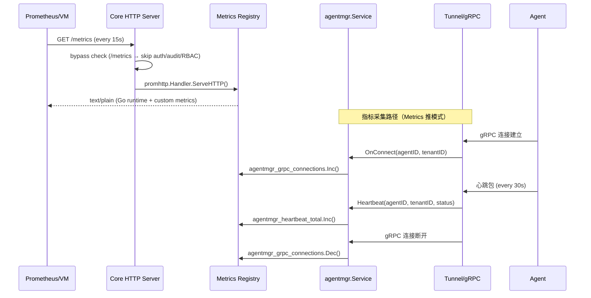
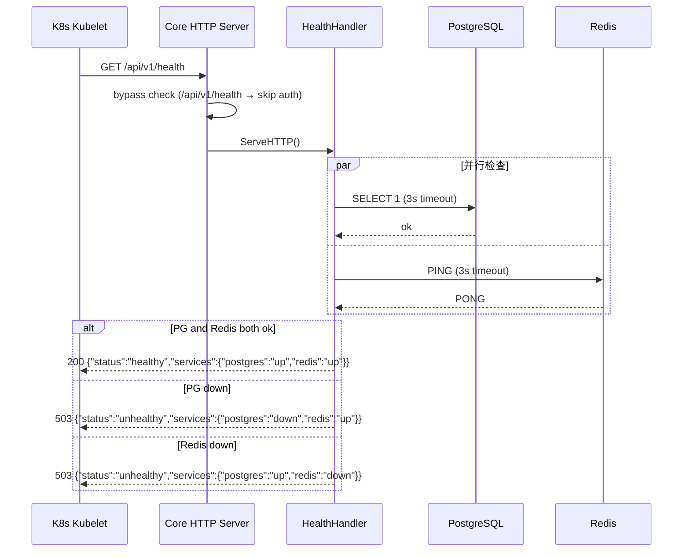
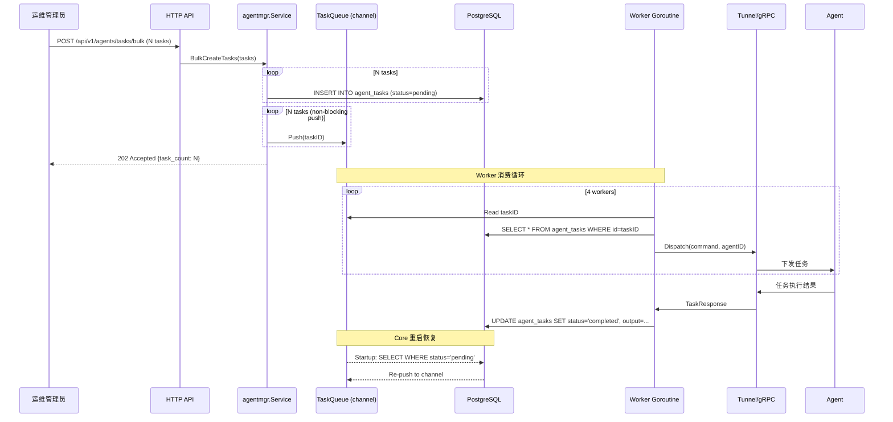
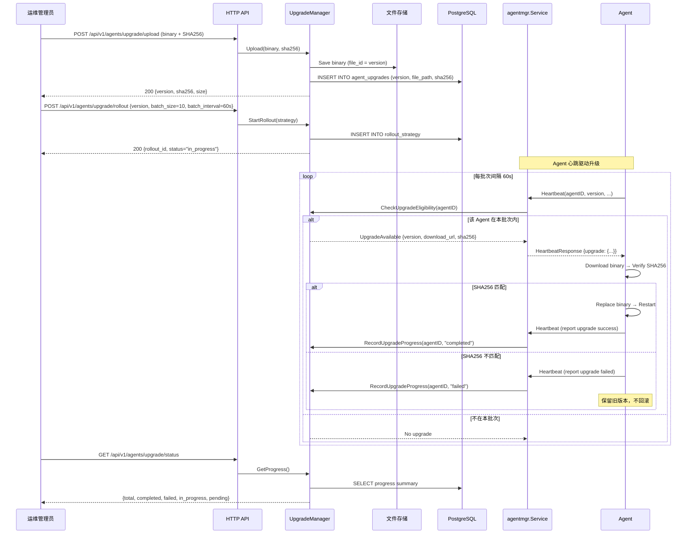

# OpsOrigin v1.2 — 可观测性 & ORM 升级 系统架构设计

| 文档版本 | 作者 | 日期 | 状态 |
|---------|------|------|------|
| v1.0 | 高见远 | 2026-07-24 | 草稿 |

---

## 1. 待确认问题决策

### Q1：Prometheus pull 模式还是 VM Remote Write？

**决策：Pull 模式，暴露 `/metrics` 端点。**

理由：
1. 当前 `go.mod` 未引入 VictoriaMetrics 客户端 SDK，pull 模式仅需 `prometheus/client_golang` 一个依赖（已在 Go 生态中极为成熟）。
2. VictoriaMetrics 原生支持 Prometheus scrape 协议，运维侧可用 VM 直接 scrape `/metrics`，与后续 VM Remote Write 等价，无需本期额外开发。
3. Pull 模式天然解耦——Core 无需感知监控后端地址，变更监控后端无需重启 Core。VM Remote Write 延后到 v1.3 多租户 SaaS 场景再评估。

### Q2：任务队列用 channel + PG 补偿还是 Redis Stream？

**决策：方案 A — Go channel + PG `agent_tasks` 补偿。**

理由：
1. 当前架构为单 Core 实例（`main.go` 无 Leader 选举逻辑），Redis Stream Consumer Group 解决的多实例竞争问题本期不存在。
2. Channel + PG 补偿实现复杂度 ~150 行，Redis Stream 需要引入 `redis/go-redis/v9` 的 Stream 消费组成熟度验证 + Consumer Group 管理，复杂度显著增加。
3. 可靠性等价：PG 是可靠持久化层；channel 丢失的任务在 Core 重启后从 `agent_tasks WHERE status='pending'` 补拉，数据不丢。Redis Stream 延后到 v1.3 多实例部署时再升级。

### Q3：ent 迁移 — 全量 schema + 单模块试点还是全量一次性？

**决策：方案 A — 全量 schema 定义 + `agentmgr` 单模块试点。**

理由：
1. ent Schema 定义为 `go generate` 的前置条件——只要 `internal/ent/schema/` 下存在文件，`go generate ./internal/ent` 就会生成全部表对应的 CRUD 客户端，不存在"只生成 agentmgr 三张表"的中间状态。因此必须一次性定义全部 schema。
2. **代码调用**层面渐进迁移：仅修改 `agentmgr/pgstore.go` 使用 ent 客户端，其余模块（notification/iam/ai/keystore/automation/itsm/cmdb）保留手写 SQL 不变。风险可控——验证通过后逐模块推广。
3. 如果一次性全量迁移 15+ 张表，需要同时修改 10+ 个 `pgstore.go`，集成测试范围过大，回归风险不可控。

---

## 2. 实现方案

### 2.1 模块一：Server 旁路路由机制（基础设施）

**目标**：让 `/metrics` 和 `/api/v1/health` 绕过 auth → audit → RBAC 中间件链。

**方案**：在 `cmd/core/server.go` 中增加旁路前缀列表，`Serve()` 方法在 middleware 链外层做路径前缀匹配，命中旁路前缀直接走 raw mux。

**改动文件**：
- `cmd/core/server.go` — 增加 `BypassPrefixes []string` 字段 + `WithBypassPrefixes(...)` 方法
- `cmd/core/main.go` — 调用 `server.WithBypassPrefixes("/metrics", "/api/v1/health")`

**伪代码逻辑**：
```
Serve() {
    wrapped = mux
    for mw in middlewares (reverse): wrapped = mw(wrapped)
    final = func(w, r):
        for prefix in bypassPrefixes:
            if r.URL.Path.HasPrefix(prefix): mux.ServeHTTP(w, r); return
        wrapped.ServeHTTP(w, r)
    listen and serve with final
}
```

### 2.2 模块二：Prometheus `/metrics` 端点（P0）

**方案**：
- 使用 `github.com/prometheus/client_golang/prometheus` 定义自定义指标
- 使用 `github.com/prometheus/client_golang/prometheus/promhttp` 暴露默认 Go 运行时指标 + 自定义 Registry
- 在 `internal/monitor/metrics/` 下创建全局 `*prometheus.Registry` 和指标注册函数

**自定义指标定义**：

| 指标名 | 类型 | Labels | 说明 |
|-------|------|--------|------|
| `agentmgr_grpc_connections` | Gauge | `instance`, `tenant_id` | 当前 gRPC 连接数 |
| `agentmgr_heartbeat_total` | Counter | `instance`, `tenant_id` | 心跳总次数 |
| `agentmgr_heartbeat_qps` | Gauge (CalculateRate) | `instance`, `tenant_id` | 心跳 QPS（瞬时） |

**HTTP 延迟**：由 `promhttp.InstrumentHandlerDuration` 中间件提供，histogram bucket 使用默认 `prometheus.DefBuckets`。

**改动文件**：
- `internal/monitor/metrics/metrics.go` [新] — 全局 Registry + 指标注册 + Handler 工厂
- `cmd/core/main.go` [改] — 用 promhttp 包装 mux 注册 `/metrics`，注入 agentmgr 指标更新回调

**指标更新点**：
- `agentmgr_grpc_connections`：`agentmgr/heartbeat.go` 中每接受/断开 gRPC 连接时 `Inc()`/`Dec()`
- `agentmgr_heartbeat_total`：`agentmgr/heartbeat.go` 中每处理一次心跳 `Inc()`

### 2.3 模块三：健康检查 `/api/v1/health`（P0）

**方案**：
- 无额外依赖，使用 `database/sql` 的 `db.PingContext()` 检测 PG，`redis.Client.Ping()` 检测 Redis
- 超时 3 秒，`context.WithTimeout`
- 响应格式：

```json
{
  "status": "healthy",
  "services": {
    "postgres": "up",
    "redis": "up"
  }
}
```

- `status: "unhealthy"` 时 HTTP 503，任一服务 `down` 则 overall unhealthy

**改动文件**：
- `internal/monitor/health/handler.go` [新] — HealthHandler 实现
- `cmd/core/main.go` [改] — 注册 `/api/v1/health` 到 mux

### 2.4 模块四：PG 连接池可配（P1）

**方案**：
- 在 `pkg/config/config.go` 中新增 `PostgresConfig` 结构体
- 环境变量：
  - `OPSNEXUS_POSTGRES_MAX_CONNS`，默认 25（0 表示无上限 + 日志 Warn）
  - `OPSNEXUS_POSTGRES_MAX_IDLE_CONNS`，默认 5
  - `OPSNEXUS_POSTGRES_CONN_MAX_LIFETIME`，默认 30m
- 在 `main.go` 中 `pgRepo` 创建后，对 `*sql.DB` 调用 `SetMaxOpenConns / SetMaxIdleConns / SetConnMaxLifetime`
- 当前 PG 连接通过 `pg.NewRepository(cfg.CMDB.PostgresDSN)` 创建 `*sql.DB`，连接池配置在 `main.go` 中统一注入

**改动文件**：
- `pkg/config/config.go` [改] — 增加 `PostgresConfig` + Load 方法
- `cmd/core/main.go` [改] — 应用连接池配置

### 2.5 模块五：任务下发队列（P1）

**方案**：Go buffered channel (size 1000) + PG `agent_tasks` 表为持久化补偿。

**架构**：

```
HTTP BulkCreateTasks
  ├── 1. INSERT N rows INTO agent_tasks (status=pending)  ← PG 可靠持久化
  ├── 2. Push task IDs to buffered channel               ← 进程内异步分发
  └── 3. Return 202 Accepted {task_count: N}

Worker goroutines (default 4)
  ├── 1. Read from channel
  ├── 2. Dispatch via tunnel/gRPC to Agent
  └── 3. Update task status on completion

Startup recovery
  └── 1. SELECT * FROM agent_tasks WHERE status='pending'
      2. Push to channel (non-blocking, up to queue size)
```

**容错设计**：
- Worker panic → `recover()` + 重试 3 次后标记 `task_failed`
- Channel 满 → 直接返回成功（任务已在 PG），后台 goroutine 每秒扫描 pending 任务补推
- Core 重启 → startup 扫描 pending 任务重新入队
- 优雅关闭 → `close(channel)` 后 drain 并标记未分发的为 pending

**配置项**：

| 环境变量 | 默认值 | 说明 |
|---------|--------|------|
| `OPSNEXUS_TASK_QUEUE_SIZE` | 1000 | channel 容量 |
| `OPSNEXUS_TASK_QUEUE_WORKERS` | 4 | worker goroutine 数 |

**改动文件**：
- `internal/agentmgr/taskqueue.go` [新] — TaskQueue 结构体 + BulkCreate/Worker/Dispatch 逻辑
- `internal/agentmgr/service.go` [改] — 注入 TaskQueue，注册 `/api/v1/agents/tasks/bulk` 端点
- `pkg/config/config.go` [改] — 增加 TaskQueueConfig
- `cmd/core/main.go` [改] — 初始化 TaskQueue + 启动 worker

### 2.6 模块六：滚动升级通道（P1）

**方案**：

**数据表**（新增）：
- `agent_upgrades` — 升级包元数据（version, file_path, sha256, size_bytes, created_at）
- `agent_upgrade_progress` — 每个 Agent 的升级进度（agent_id, upgrade_id, status, started_at, completed_at, error）

**API 端点**：

| 方法 | 路径 | 说明 |
|------|------|------|
| POST | `/api/v1/agents/upgrade/upload` | 上传 Agent 二进制（multipart/form-data），返回 SHA256 |
| POST | `/api/v1/agents/upgrade/rollout` | 设定升级策略 `{version, batch_size, batch_interval}` |
| GET | `/api/v1/agents/upgrade/status` | 查询升级进度汇总 |

**心跳集成**：
- Agent 心跳响应增加 `upgrade` 字段（可选），包含 `{version, download_url, sha256, force}`
- Core 根据 rollout 策略（`batch_size` + `batch_interval`）控制每批返回 upgrade 指令的 Agent 数量
- Agent 收到指令后：下载 → 校验 SHA256 → 替换二进制 → 重启 → 下次心跳报告升级结果

**安全校验**：
- 上传时 Core 计算并存储 SHA256
- Agent 下载后校验本地 SHA256 与 Core 下发一致
- 不匹配 → 拒绝升级，状态标记 `upgrade_failed`，保留旧版本

**配置项**：

| 环境变量 | 默认值 | 说明 |
|---------|--------|------|
| `OPSNEXUS_UPGRADE_DEFAULT_BATCH_SIZE` | 10 | 默认每批升级数量 |
| `OPSNEXUS_UPGRADE_DEFAULT_BATCH_INTERVAL` | 60s | 默认批次间隔 |

**改动文件**：
- `internal/agentmgr/upgrade.go` [新] — UpgradeManager 结构体 + upload/rollout/status 逻辑
- `internal/agentmgr/service.go` [改] — 注册升级端点，心跳响应集成 upgrade 指令
- `internal/agentmgr/model.go` [改] — 增加 UpgradeInfo/UpgradeProgress/RolloutStrategy 类型
- `pkg/config/config.go` [改] — 增加 UpgradeConfig
- `cmd/core/main.go` [改] — 初始化 UpgradeManager

### 2.7 模块七：ent ORM Schema 定义 + agentmgr 试点迁移

**Schema 目录结构**：
```
internal/ent/
  └── schema/             [新]
      ├── agent_host.go     — agent_hosts
      ├── agent_proxy.go    — agent_proxies
      ├── agent_task.go     — agent_tasks
      ├── notification_channel.go
      ├── notification_policy.go
      ├── notification_history.go
      ├── iam_role.go
      ├── iam_group.go
      ├── iam_user_role.go
      ├── ai_conversation.go
      ├── keystore_entry.go
      ├── automation_script.go
      ├── automation_workflow.go
      ├── automation_scheduler.go
      ├── itsm_knowledge.go
      ├── itsm_oncall.go
      ├── cmdb_asset.go
```

**生成产物**：
```
internal/ent/
  ├── client.go           [自动生成]
  ├── agenthost.go        [自动生成]
  ├── agenthost_create.go [自动生成]
  ├── ...                 [自动生成]
  └── ent.go              [自动生成]
```

**ent Client 初始化**（`pkg/db/entdb.go`）：
```go
func NewEntClient(drv *sql.DB) (*ent.Client, error) {
    client := ent.NewClient(ent.Driver(drv))
    // AutoMigration only in dev mode
    return client, nil
}
```

**agentmgr 试点迁移**：
- `pgstore.go` 中所有 `s.db.ExecContext` / `s.db.QueryRowContext` 替换为 ent 链式调用
- 示例：`Register()` 从手写 SQL + 30 个 `$N` 参数 → `client.AgentHost.Create().SetXXX().OnConflict().UpdateXXX().Exec(ctx)`
- 保持 `pgStore` 对外接口不变，确保 `service.go` 零改动

**改动文件**：
- `internal/ent/schema/*.go` [17 个新文件] — 全量表 schema 定义
- `internal/ent/generate.go` [新] — `//go:generate go run entgo.io/ent/cmd/ent generate ./schema`
- `pkg/db/entdb.go` [新] — ent Client 初始化封装
- `internal/agentmgr/pgstore.go` [重构] — 试点迁移到 ent
- `Makefile` [改] — 增加 `generate` target
- `cmd/core/main.go` [改] — 初始化 ent Client 注入 agentmgr

**ent schema 编写规范**：
- 每个 schema 文件包含 `func (T) Fields() []ent.Field` 和 `func (T) Edges() []ent.Edge`
- 字段使用 ent 内置类型：`field.String`, `field.Int`, `field.Time`, `field.JSON`（用于 JSON 字段如 labels/capabilities）
- 索引使用 `func (T) Indexes() []ent.Index`
- 表名如需与结构体名不同，使用 `func (T) Annotations() []schema.Annotation` 配合 `entsql.Annotation{Table: "agent_hosts"}`

---

## 3. 文件变更清单

### 3.1 新增文件

| 文件路径 | 模块 | 说明 |
|---------|------|------|
| `internal/ent/generate.go` | ent ORM | go:generate 指令 |
| `internal/ent/schema/agent_host.go` | ent ORM | agent_hosts schema |
| `internal/ent/schema/agent_proxy.go` | ent ORM | agent_proxies schema |
| `internal/ent/schema/agent_task.go` | ent ORM | agent_tasks schema |
| `internal/ent/schema/notification_channel.go` | ent ORM | notification_channels schema |
| `internal/ent/schema/notification_policy.go` | ent ORM | notification_policies schema |
| `internal/ent/schema/notification_history.go` | ent ORM | notification_history schema |
| `internal/ent/schema/iam_role.go` | ent ORM | iam_roles schema |
| `internal/ent/schema/iam_group.go` | ent ORM | iam_groups schema |
| `internal/ent/schema/iam_user_role.go` | ent ORM | iam_user_roles schema |
| `internal/ent/schema/ai_conversation.go` | ent ORM | ai_conversations schema |
| `internal/ent/schema/keystore_entry.go` | ent ORM | keystore_entries schema |
| `internal/ent/schema/automation_script.go` | ent ORM | 脚本表 schema |
| `internal/ent/schema/automation_workflow.go` | ent ORM | 工作流表 schema |
| `internal/ent/schema/automation_scheduler.go` | ent ORM | 定时任务表 schema |
| `internal/ent/schema/itsm_knowledge.go` | ent ORM | 知识库表 schema |
| `internal/ent/schema/itsm_oncall.go` | ent ORM | 值班表 schema |
| `internal/ent/schema/cmdb_asset.go` | ent ORM | CMDB 资产表 schema |
| `pkg/db/entdb.go` | ent ORM | ent Client 初始化封装 |
| `internal/monitor/metrics/metrics.go` | 可观测性 | Prometheus 指标注册 + Handler |
| `internal/monitor/health/handler.go` | 可观测性 | 健康检查 Handler |
| `internal/agentmgr/taskqueue.go` | 任务队列 | TaskQueue 实现 |
| `internal/agentmgr/upgrade.go` | 滚动升级 | UpgradeManager 实现 |

**合计：23 个新文件**

### 3.2 修改文件

| 文件路径 | 模块 | 改动说明 |
|---------|------|---------|
| `cmd/core/server.go` | 基础设施 | 增加 `BypassPrefixes` 字段 + `WithBypassPrefixes()` 方法 |
| `cmd/core/main.go` | 基础设施 | 注入 ent Client、连接池配置、TaskQueue、UpgradeManager；注册 /metrics、/health；配置 bypass 前缀；添加 promhttp 中间件 |
| `pkg/config/config.go` | 配置 | 新增 `PostgresConfig`、`TaskQueueConfig`、`UpgradeConfig` 结构体 |
| `internal/agentmgr/pgstore.go` | ORM 试点 | 重构为 ent 调用 |
| `internal/agentmgr/service.go` | 多模块 | 注册任务队列/升级端点；注入 metrics 指标更新 |
| `internal/agentmgr/model.go` | 多模块 | 新增 UpgradeInfo 等类型 |
| `internal/agentmgr/heartbeat.go` | 可观测性 | 增加 Prometheus 指标打点 |
| `Makefile` | 构建 | 增加 `generate` target |

**合计：8 个修改文件**

---

## 4. 数据流 / 调用链（Mermaid）

### 4.1 Prometheus 指标采集流



### 4.2 健康检查流



### 4.3 任务队列流



### 4.4 滚动升级流



---

## 5. 有序任务列表

任务按依赖关系排序，每个任务列出预估改动文件数。

| 序号 | 任务 | 依赖 | 改动文件数 | 说明 |
|------|------|------|-----------|------|
| **T01** | 引入依赖包 | 无 | 2 | `go get prometheus/client_golang`, `go get entgo.io/ent`，更新 `go.mod` + `go.sum` |
| **T02** | 配置模块扩展 | 无 | 1 | `pkg/config/config.go` 增加 PostgresConfig / TaskQueueConfig / UpgradeConfig |
| **T03** | Server 旁路路由机制 | 无 | 1 | `cmd/core/server.go` 增加 `BypassPrefixes` |
| **T04** | ent 全量 schema 定义 | T01 | 18 | `internal/ent/schema/*.go` (17 表) + `internal/ent/generate.go` |
| **T05** | `go generate` + ent 生成代码 | T04 | 0 (自动生成) | `go generate ./internal/ent`，生成 client 文件 |
| **T06** | ent Client 初始化封装 | T05 | 1 | `pkg/db/entdb.go` |
| **T07** | `/metrics` Prometheus 端点 | T01, T03 | 2 | `internal/monitor/metrics/metrics.go` [新] + `cmd/core/main.go` [改] |
| **T08** | `/api/v1/health` 健康检查端点 | T03 | 2 | `internal/monitor/health/handler.go` [新] + `cmd/core/main.go` [改] |
| **T09** | PG 连接池可配化 | T02 | 1 | `cmd/core/main.go` 应用 PostgresConfig |
| **T10** | agentmgr ent 试点迁移 | T05, T06 | 2 | `internal/agentmgr/pgstore.go` [重构] + `cmd/core/main.go` [注入 ent Client] |
| **T11** | 任务下发队列 | T02 | 3 | `internal/agentmgr/taskqueue.go` [新] + `internal/agentmgr/service.go` [改] + `cmd/core/main.go` [改] |
| **T12** | 滚动升级通道 | T02 | 4 | `internal/agentmgr/upgrade.go` [新] + `internal/agentmgr/model.go` [改] + `internal/agentmgr/service.go` [改] + `cmd/core/main.go` [改] |
| **T13** | 可观测性指标打点 | T07 | 1 | `internal/agentmgr/heartbeat.go` 增加 Prometheus Counter/Gauge 更新 |
| **T14** | Makefile 增加 generate target | T04 | 1 | `Makefile` |
| **T15** | 集成测试 + 联调 | T08-T13 | 3+ | `internal/agentmgr/service_test.go` [改] + 新增 upgrade/taskqueue 测试 |

### 任务依赖图

```
T01 (依赖包)
 ├── T04 (ent schema)
 │    └── T05 (go generate)
 │         └── T06 (ent client)
 │              └── T10 (agentmgr ent 试点)
 ├── T07 (metrics)
 │    └── T13 (指标打点)
 └── (基础依赖完成)

T02 (配置扩展)
 ├── T09 (PG 连接池)
 ├── T11 (任务队列)
 └── T12 (滚动升级)

T03 (旁路路由)
 ├── T07 (metrics)
 └── T08 (health)

T08-T13 (功能模块) → T15 (集成测试)
T14 (Makefile) 可与 T04 并行
```

**建议执行顺序**：T01 + T02 + T03 → (T04-T06) 并行 (T07-T08) → T09 → T10 → T11 → T12 → T13 → T14 → T15

---

## 6. 依赖包清单

| 包 | 版本 | 用途 | `go get` 命令 |
|----|------|------|-------------|
| `github.com/prometheus/client_golang` | v1.21+ | Prometheus 指标 + `/metrics` 端点 | `go get github.com/prometheus/client_golang@latest` |
| `entgo.io/ent` | v0.14+ | ORM Schema-as-Code + 代码生成 | `go get entgo.io/ent@latest` |
| `entgo.io/ent/cmd/ent` | v0.14+ | ent CLI 工具（仅 go:generate 使用，不进入编译产物） | `go install entgo.io/ent/cmd/ent@latest` |

**间接依赖**（由以上包自动引入，无需手动 `go get`）：
- `github.com/cespare/xxhash/v2` — 已有（v2.3.0，redis 的间接依赖），prometheus 也可复用
- `github.com/prometheus/client_model` — prometheus/client_golang 自动引入
- `github.com/prometheus/common` — prometheus/client_golang 自动引入
- `github.com/prometheus/procfs` — prometheus/client_golang 自动引入
- `github.com/beorn7/perks` — prometheus/client_golang 自动引入

**无需额外引入的依赖**（已验证 `go.mod` 已有）：
- `github.com/lib/pq` — PG 驱动，已有 v1.12.3
- `github.com/redis/go-redis/v9` — Redis 客户端，已有 v9.21.0
- `github.com/google/uuid` — UUID 生成，已有 v1.6.0

---

## 7. 共享知识约定

### 7.1 `/metrics` 和 `/health` 跳过 auth 中间件的实现方式

**原则**：不在各中间件内部加 `if path == "/metrics" { skip }` 的分散判断，而是统一在 Server 层做旁路。

**实现**（`cmd/core/server.go`）：

```go
// Server 增加字段
type Server struct {
    // ... 原有字段
    bypassPrefixes []string
}

// 新方法
func (s *Server) WithBypassPrefixes(prefixes ...string) {
    s.bypassPrefixes = append(s.bypassPrefixes, prefixes...)
}

// Serve() 中，在 middleware 链外层加 bypass 检查
func (s *Server) Serve(ctx context.Context) error {
    var wrapped http.Handler = s.mux
    for i := len(s.middlewares) - 1; i >= 0; i-- {
        wrapped = s.middlewares[i](wrapped)
    }

    // 最外层：旁路检查
    final := http.HandlerFunc(func(w http.ResponseWriter, r *http.Request) {
        for _, prefix := range s.bypassPrefixes {
            if strings.HasPrefix(r.URL.Path, prefix) {
                s.mux.ServeHTTP(w, r)  // 跳过所有 middleware
                return
            }
        }
        wrapped.ServeHTTP(w, r)
    })

    srv := &http.Server{Addr: s.addr, Handler: final, ...}
    ...
}
```

**`main.go` 中注册**：
```go
server.WithBypassPrefixes("/metrics", "/api/v1/health")
```

### 7.2 ent Schema 目录约定

| 约定项 | 规则 |
|-------|------|
| Schema 文件位置 | `internal/ent/schema/` |
| 文件命名 | `{table_name}.go`（蛇形命名，如 `agent_host.go`） |
| 结构体命名 | `{TableName}`（大驼峰，如 `AgentHost`） |
| 表名覆盖 | 结构体名 ≠ 表名时，使用 `entsql.Annotation{Table: "actual_table_name"}` |
| 字段类型 | `field.String/Int/Time/JSON/Bool/Enum/Float` |
| JSON 字段 | `field.JSON`（用于 labels/capabilities/ips 等 `jsonb` 列） |
| 索引定义 | `func (T) Indexes() []ent.Index` |
| 外键/关联 | `func (T) Edges() []ent.Edge` |
| go:generate 入口 | `internal/ent/generate.go` 中 `//go:generate go run entgo.io/ent/cmd/ent generate ./schema` |
| 构建顺序 | `go generate ./internal/ent` → `go build ./...`（Makefile 中的 `generate` target 先于 `build`） |

### 7.3 指标命名约定

| 约定项 | 规则 | 示例 |
|-------|------|------|
| 前缀 | `{模块名}_` | `agentmgr_` |
| 分隔符 | 下划线 | `agentmgr_grpc_connections` |
| 单位后缀 | 类型名后缀（`_total` 用于 Counter，`_seconds` 用于时间，`_bytes` 用于大小） | `agentmgr_heartbeat_total` |
| 公共 Labels | `instance`, `tenant_id` | 指标注册时默认包含 |
| Registry | 全局共享 `*prometheus.Registry`，位于 `internal/monitor/metrics` | `metrics.Registry` |
| 指标暴露 | 各业务模块通过回调或全局变量更新指标值，不对 `internal/monitor/metrics` 生成循环依赖 | 利用 `var` 全局变量直接操作 |

### 7.4 任务队列约定

| 约定项 | 规则 |
|-------|------|
| 启动 | `TaskQueue.Start(ctx)` 在 `main.go` 中调用，传入 worker 数量 |
| 关闭 | `TaskQueue.Shutdown()` → close channel → drain → 标记 pending → 返回 |
| 补偿扫描 | `TaskQueue.recoverLoop(ctx)` — 每 5s 扫描 `agent_tasks WHERE status='pending' LIMIT queueSize`，非阻塞 push |
| 错误处理 | worker panic → recover + 重试 3 次 → 标记 task_failed |
| 队列满 | push 用 `select { case ch <- id: default: }` — 不阻塞，依赖补偿扫描 |
| 幂等性 | BulkCreateTasks 可被重复调用，通过 task_id 去重（ON CONFLICT DO NOTHING） |

### 7.5 配置结构体命名约定

```go
type Config struct {
    // 新增
    Postgres PostgresConfig   `json:"postgres"`
    TaskQueue TaskQueueConfig `json:"task_queue"`
    Upgrade   UpgradeConfig   `json:"upgrade"`
    // ... 原有字段
}

type PostgresConfig struct {
    MaxConns        int           // OPSNEXUS_POSTGRES_MAX_CONNS, 默认 25
    MaxIdleConns    int           // OPSNEXUS_POSTGRES_MAX_IDLE_CONNS, 默认 5
    ConnMaxLifetime time.Duration // OPSNEXUS_POSTGRES_CONN_MAX_LIFETIME, 默认 30m
}

type TaskQueueConfig struct {
    QueueSize int // OPSNEXUS_TASK_QUEUE_SIZE, 默认 1000
    Workers   int // OPSNEXUS_TASK_QUEUE_WORKERS, 默认 4
}

type UpgradeConfig struct {
    DefaultBatchSize    int           // OPSNEXUS_UPGRADE_DEFAULT_BATCH_SIZE, 默认 10
    DefaultBatchInterval time.Duration // OPSNEXUS_UPGRADE_DEFAULT_BATCH_INTERVAL, 默认 60s
}
```

### 7.6 agentmgr ent 迁移约定

| 约定项 | 规则 |
|-------|------|
| 接口不变 | `pgStore` 的方法签名保持不变（`Register/Get/List/Update/Delete/Heartbeat/BulkHeartbeat/CreateTask/ListTasks/CompleteTask`），仅内部实现切换到 ent |
| 双写禁止 | Phase 1 不双写——`pgStore` 完全使用 ent，旧 SQL 代码删除 |
| 事务 | ent 的 `Tx` 替代 `db.BeginTx`（如 `Delete` 中删除 Agent + 关联 Task） |
| 批量操作 | `BulkHeartbeat` 使用 ent 的 `sql/execquery` driver-level 批量 insert（避免逐条 exec 性能劣化） |

---

## 附录：风险点与缓解

| 风险 | 影响 | 缓解措施 |
|------|------|---------|
| ent 生成代码与手写 SQL 行为不一致 | agentmgr API 响应变化 | 保持 `pgStore` 接口 + `service_test.go` 验证 |
| TaskQueue channel 满后补偿失效 | 新任务延迟分发 | 补偿扫描间隔 5s + 配置项可调 |
| 滚动升级 SHA256 不匹配 | Agent 升级失败 | 上传时二次校验 + Agent 端校验 + 失败不重启 |
| promhttp 增加 HTTP 延迟开销 | API P99 上升 | `promhttp.InstrumentHandlerDuration` 仅对需要采集的路径启用（可选，P0 阶段默认全局） |
| ent 自动迁移 vs 现有 DDL 冲突 | 表结构被意外修改 | Phase 1 禁用 AutoMigration，仅使用 ent CRUD |
