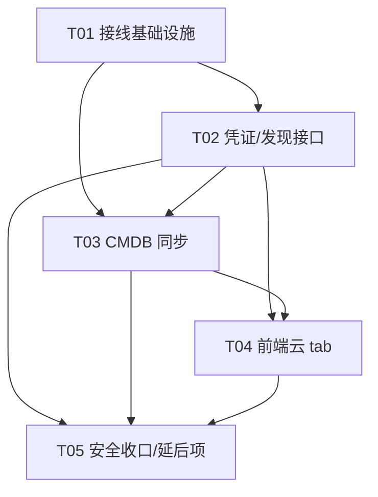

# OpsOrigin 云资源「接出」设计文档

> 目标：把已写好的 `internal/cloud/` 多云纳管库能力，通过 HTTP 暴露给前端，并把发现的云资源同步进 CMDB（成为 CI）。
> 范围：仅设计，不含实现。分期：MVP = AWS + 阿里云 + 腾讯云 + 华为云 的 VM / 数据库 / 负载均衡（VM/DB/LB）。
> 原则：最小变更、不破坏现有主机 / vuln / cmdb 流程、沿用现有 service/route/CMDB 范式、零新增第三方依赖。

---

## 0. 现状核查结论（设计依据）

| 核查项 | 结论 |
|------|------|
| `internal/cloud/` 库是否真实存在 | ✅ 真实。`types.go`(Provider 接口 / Resource / Metric / Credential / ResourceType 常量)、`creds.go`(Store 接口 + MemStore + Collector)、`registry.go`(Provider 注册表)、`providers/{aws,tencent,aliyun,huawei}` 均真实现 |
| 是否已被「接出」 | ❌ 未被接出。`grep cmd/` 无 `cloudSvc.RegisterRoutes`、无 `/api/v1/cloud` 端点 |
| **Provider 是否真的注册了** | ❌ **关键缺口**：4 个 provider 包只在各自 `init()` 里 `cloud.Register`，但**全仓库没有任何包 import 它们**（仅 provider 包自身 import `internal/cloud`）。因此运行时 `cloud.Names()` 为空，`cloud.Get(provider)` 永远 `ProviderNotFound`。**这是接出的 #1 前置 blocker** |
| 前端云 tab | ❌ 完全占位：`resources/page.tsx` 的 `cloud` TabsContent 是「即将上线」Card，无任何 API 调用 |
| CMDB 集成范式 | ✅ `internal/vuln/service.go` 的 `cmdbInventoryAdapter`（在 `cmd/core/main.go`）直接拿 `pg.Repository.ListCI` 把 CI 映射成资产清单——这是「上层读 CMDB」的范式 |
| CMDB 写范式 | `internal/cmdb/service.go` 的 `handleCreateCI` 写 `pg.CreateCI` 并触发 `onCICreated → monitorTopo.RecordTenant`；另有 `BulkCreateCI`（经 ingest 异步批量） |
| 路由 / 中间件范式 | `cmd/core/server.go`：`Service.RegisterRoutes(mux)` 聚合；中间件链 auth→audit→rbac；`AutoPermissionMiddleware` 对**未登记路径默认放行（仅要求已认证）** |
| 缺失能力 | Azure 后端无 provider；VPC/Bucket/K8sCluster 有常量但 provider `default: continue` 跳过；`CollectMetrics` 全占位返回 nil |

---

## 1. 云资源 Service 设计（`internal/cloud/service.go`）

### 1.1 包定位决策（重要）

`internal/cloud` 现有 doc 注释明确它是「纯库，上层（采集调度、CMDB 同步、UI）无需感知具体厂商 SDK」。为**保持纯库性**并**复用 vuln 的解耦范式**，采用：

- **`internal/cloud` 只定义契约与 HTTP 层**：`Service` 结构体、`RegisterRoutes`、凭证解析、以及一个 `CMDBWriter` 接口（**不 import `cmdb`**）。
- **CMDB 适配放在 `cmd/core/cloud_adapter.go`**：实现 `CMDBWriter`，内部 import `internal/cmdb`（与 `cmdbInventoryAdapter` 同层、同风格）。这样 `internal/cloud` 不直接依赖 `cmdb`，且无 import 环（`cmdb` 不 import `cloud`，已 grep 验证）。

### 1.2 凭证管理：如何接收 / 存储

`Credential` 结构已存在（`Provider/Region/AccessKey/SecretKey/Extra`）。设计两条等价入口：

1. **临时凭证（MVP 主路径，零持久化）**：发现 / 同步请求体直接带 `provider/region/access_key/secret_key/extra`，Service 就地构造 `Credential` 调 provider。**不落库、天然多租户安全**（每个请求自带凭证）。
2. **持久凭证（P1 增强）**：`POST /api/v1/cloud/credentials` 写入 `Store`（`MemStore` 已存在，重启即失；生产应选 PG 加密存储——见§9 待确认）。后续可用 `{credential_id}` 引用。

**MVP 选型建议**：先用路径 1（临时凭证），`Store` 仅作可选持久层。理由：零新增依赖、无租户隔离复杂度、契合演示。生产化（加密持久 + KMS）列为待确认。

**安全注意**：Secret 经请求体传输，会被 audit 中间件记录 → 需对 `/api/v1/cloud/credentials` 路径做 body 脱敏 / 跳过内容记录（参考 keystore 的 secret 处理），见 T05 / §9。

### 1.3 `ListResources`（暴露核心能力）

`Service` 内部：
```
p, err := cloud.Get(provider)        // 从注册表取 Provider
cred := resolveCredential(req)        // 来自请求体或 Store
res, err := p.ListResources(ctx, cred, region, kinds)  // kinds: []ResourceType
return res                            // []Resource（已是 CMDB 可映射结构）
```
- `kinds` 来自前端多选（MVP 仅 `vm/database/load_balancer`）；provider 内部 `parseKind` 已支持字符串→`ResourceType`，AWS 仅实现三类。
- 返回结构 `Resource` 直出 JSON（已带 json tag）。

### 1.4 `RegisterRoutes`（Core mux 注册）

`Service` 实现 `routeRegistrar`（`RegisterRoutes(mux *http.ServeMux)`），由 `cmd/core/main.go` 调 `server.RegisterService(cloudSvc)` 聚合进 Core 网关，自动获得 auth→audit→rbac 中间件链。

路由表（前缀 `/api/v1/cloud`，使用 Go 1.22+ 模式匹配）：
| 方法 & 路径 | 说明 |
|---|---|
| `GET /api/v1/cloud/providers` | 返回 `cloud.Names()` + 各厂商支持的 types（MVP 全局支持 vm/db/lb） |
| `GET /api/v1/cloud/credentials` | 列出本作用域凭证（**不返回 secret**） |
| `POST /api/v1/cloud/credentials` | 保存凭证到 `Store` |
| `DELETE /api/v1/cloud/credentials/{id}` | 删除凭证 |
| `POST /api/v1/cloud/resources/list` | body{provider,region,types[],credential?/credential_id?} → `[]Resource` |
| `POST /api/v1/cloud/resources/sync` | body{provider,region,types[],resources?[]} → 发现并同步 CMDB，返回 `{created,updated,skipped,failed,errors}` |

> 响应约定沿用 vuln：`writeJSON(w, status, v)` / `writeError(w, status, msg)`（统一 JSON）。租户取自 `ctx.Value("tenant_id")`（参考 vuln `tenantFromCtx`，默认 `"default"`）。

---

## 2. CMDB 同步设计

### 2.1 写入路径选择（关键）

**不**直接调 `pg.Repository.CreateCI` —— 那样会绕过 `cmdb.Service` 的 `onCICreated → monitorTopo.RecordTenant` 联动与 schema 校验 / anti-flapping。**应通过 `cmdb.Service`**：新增导出方法 `cmdb.Service.CreateCI(ctx, ci, traceID)` / `UpdateCI(ctx, ci, ch, traceID)`（复用 `handleCreateCI` 既有逻辑，最小化改动），使云同步复用完整 CI 生命周期。适配器同时持有 `pgRepo`（仅用于去重读取，与 vuln 同范式）与 `cmdbSvc`（写入）。

### 2.2 CI 类型与映射

- **CI type_id 命名**：按资源类型固定常量 `cloud_vm` / `cloud_database` / `cloud_load_balancer`（延后项对应 `cloud_vpc` / `cloud_bucket` / `cloud_k8s_cluster`）。无需预先建 model-type（CMDB 允许自由 type_id；如需强 schema 校验可后续经 `/api/v1/cmdb/model-type` 注册）。
- **`Resource → CIModel` 映射**：
  - `TypeID` = 上述常量；`TenantID` = ctx；`Name` = `Resource.Name`（空则回退 `ID`）；`Status` = `active`；`Channel` = `WeightDiscovery`(30)（标识「自动发现」来源，低于 ITSM/Human，受 anti-flapping 保护——人工改过的 CI 不会被自动覆盖，符合预期）；
  - `Attributes`：`provider, resource_type, region, zone, status, public_ip, private_ip, resource_id(=Resource.ID), labels, extra`；
  - `Labels`：`Resource.Labels` 透传。

### 2.3 幂等 / 增量（upsert）

- 自然键：`attributes["resource_id"] = "<provider>:<type>:<id>"`。
- 同步时先 `pgRepo.ListCI(tenant, typeID)` 一次，建 `resource_id → existingCI` 索引；
- 对每个 resource：已存在 → `cmdbSvc.UpdateCI(ci, WeightDiscovery)`；不存在 → `cmdbSvc.CreateCI(ci)`。
- 大量资源时，新建部分可改用 `cmdbSvc.BulkCreateCI`（异步 ingest，202 即返）。
- 返回 `{created, updated, skipped, failed, errors}` 给前端。

### 2.4 事件链复用

`CreateCI` 内部写 `cmdb_ci` 并发 outbox 事件 `EventCICreated` → outbox worker 同步 dgraph；同时 `onCICreated` 回调触发 `monitorTopo.RecordTenant(ciID, tenantID)`。**云资源进 CMDB 后自动进入拓扑与 dgraph，零额外接线。**

---

## 3. 前端改造（`resources/page.tsx` 云 tab 真实化）

### 3.1 新增 store（复用既有模式）

新建 `web-next/src/stores/cloud.ts`（zustand，镜像 `agent.ts`）：
- `fetchProviders()` → `GET /cloud/providers`
- `listCredentials()` / `saveCredential()` / `deleteCredential()` → 凭证管理
- `listResources(req)` → `POST /cloud/resources/list`
- `syncToCMDB(req)` → `POST /cloud/resources/sync`

全部走现有 `apiFetch`（`@/lib/utils`，已统一带 `Authorization` / `X-Trace-ID` / `X-Principal-*`），**无需新封装**。类型放 `web-next/src/lib/cloud.ts`（`CloudProvider / CloudCredential / CloudResource / SyncResult`）。

### 3.2 云 tab UI（替换占位 Card）

复用现有 `Card / Input / Select / Button / Badge / Dialog / DataList` 组件，结构对照主机 tab：
1. **凭证区**：云商下拉（`providers` 列表）、Region、AccessKey、SecretKey、厂商特有 Extra（可选）；「保存凭证」按钮（可选持久化）。
2. **资源类型多选**：VM / 数据库 / 负载均衡（MVP 三项；VPC/Bucket/K8s/Azure 灰显或隐藏）。
3. **「发现资源」按钮** → `listResources` → `DataList` 表格展示（云商 / 类型 / ID / 名称 / 地域 / 状态 / 公网IP / 私网IP），支持多选。
4. **「纳管到 CMDB」按钮** → `syncToCMDB` → toast 显示 `created/updated/skipped`，并提示可在 CMDB 页查看。
5. 复用主机 tab 的 `apiFetch` 错误处理与 `toast`。

> 不混入 SSH `keys` store（云 AK/SK 与 SSH 密钥语义不同）；如需从 keystore 选取 AK 可作 P2 增强。

---

## 4. 文件清单（相对路径）

**新增后端**
- `internal/cloud/providers/all/all.go` —— 聚合空白导入 aws/tencent/aliyun/huawei（触发 `init()` 注册）
- `internal/cloud/service.go` —— `Service` 结构体 + `NewService` + `RegisterRoutes` + `CMDBWriter` 接口 + `SyncResult`
- `internal/cloud/http_credential.go` —— 凭证 CRUD + providers 列表 handler
- `internal/cloud/http_resource.go` —— `resources/list` handler
- `internal/cloud/http_sync.go` —— `resources/sync` handler
- `internal/cloud/cmdb_sync.go` —— `Resource→CIModel` 映射 + CI 类型常量 + upsert 编排
- `cmd/core/cloud_adapter.go` —— `cloudCMDBAdapter` 实现 `CMDBWriter`（import `cmdb` + `pg`）

**修改后端**
- `cmd/core/main.go` —— import `providers/all`；构造 `cloudSvc` 并 `server.RegisterService(cloudSvc)`
- `internal/cmdb/service.go` —— 新增导出 `CreateCI` / `UpdateCI` 方法（复用 `handleCreateCI` 逻辑）

**新增前端**
- `web-next/src/stores/cloud.ts` —— 云资源 zustand store
- `web-next/src/lib/cloud.ts` —— 共享 TS 类型 / 常量

**修改前端**
- `web-next/src/app/(dashboard)/resources/page.tsx` —— 云 tab 从占位改为真实（凭证表单 + 云商选择 + 资源表格 + 纳管按钮）

**延后项（T05）**
- `internal/cloud/providers/azure/provider.go` —— Azure 占位 provider（仅 `Name()=="azure"`，`ListResources` 返回未实现）
- `pkg/auth/rbac.go` 或 audit 中间件 —— 对 `/api/v1/cloud/credentials` 做审计脱敏

---

## 5. 数据结构 / 接口草图（classDiagram）

见 [`docs/class-diagram.mermaid`](./class-diagram.mermaid)。要点：

- `Provider`（接口，aws/tencent/aliyun/huawei 实现）、`Credential`、`Resource`、`Store`（接口）/ `MemStore` 为**现有库**。
- 新增 `Service`（含 `Store` + `CMDBWriter` 组合）、`CMDBWriter` 接口、`SyncResult`、`cloudCMDBAdapter`（实现 `CMDBWriter`，桥接 `cmdb.Service` + `pg.Repository`）、`CIModel`（现有 cmdb 模型）。

```mermaid
classDiagram
    direction LR

    class Provider {
        <<interface>>
        +Name() string
        +ListResources(ctx, cred Credential, region string, kinds []ResourceType) []Resource
        +GetResource(ctx, cred, region, kind, id string) *Resource
        +CollectMetrics(ctx, cred, region string, resources []Resource) []Metric
    }
    class AWSProvider {
        +Name() string
        +ListResources(...) []Resource
    }
    class Credential {
        +Provider string
        +Region string
        +AccessKey string
        +SecretKey string
        +Extra map~string,string~
    }
    class Resource {
        +Provider string
        +Type ResourceType
        +ID string
        +Name string
        +Region string
        +Zone string
        +Status string
        +PublicIP string
        +PrivateIP string
        +Labels map~string,string~
        +Extra map~string,any~
        +DiscoveredAt time.Time
    }
    class Store {
        <<interface>>
        +Save(cred Credential) error
        +Get(provider, id string) *Credential
        +List(provider string) []Credential
        +Delete(provider, id string) error
    }
    class MemStore {
        -creds map~string,map~string,Credential~~
        +Save(cred) error
        +Get(provider, id) *Credential
        +List(provider) []Credential
        +Delete(provider, id) error
    }
    class CMDBWriter {
        <<interface>>
        +SyncResources(ctx context.Context, tenantID string, resources []Resource) SyncResult
    }
    class SyncResult {
        +Created int
        +Updated int
        +Skipped int
        +Failed int
        +Errors []string
    }
    class Service {
        -store Store
        -cmdb CMDBWriter
        +NewService(store Store, cmdb CMDBWriter) *Service
        +RegisterRoutes(mux *http.ServeMux)
        -handleListProviders(w, r)
        -handleCredential(w, r)
        -handleListResources(w, r)
        -handleSyncResources(w, r)
    }
    class cloudCMDBAdapter {
        -pg *pg.Repository
        -cmdbSvc *cmdb.Service
        +SyncResources(ctx, tenantID, resources) SyncResult
    }
    class CIModel {
        +ID string
        +TypeID string
        +TenantID string
        +Name string
        +Status CIStatus
        +Attributes map~string,any~
        +Labels map~string,string~
        +Channel ChannelWeight
    }
    class cmdbService {
        +CreateCI(ctx, ci *CIModel, traceID string) error
        +UpdateCI(ctx, ci *CIModel, ch ChannelWeight, traceID string) error
    }

    Provider <|.. AWSProvider
    Store <|.. MemStore
    CMDBWriter <|.. cloudCMDBAdapter
    Service o-- Store : 凭证存储
    Service o-- CMDBWriter : CMDB 推送
    Service ..> Provider : cloud.Get(name)
    Service ..> Resource : 列举返回
    cloudCMDBAdapter ..> CIModel : Resource→CIModel
    cloudCMDBAdapter ..> cmdbService : CreateCI/UpdateCI
    cloudCMDBAdapter ..> "pg.Repository" : ListCI 去重
    CIModel ..> Resource : 由 Resource 映射
```

---

## 6. 调用流程（时序，sequenceDiagram）

见 [`docs/sequence-diagram.mermaid`](./sequence-diagram.mermaid)。包含三段：① 启动接线 ② 发现资源 ③ 同步 CMDB。

---

## 7. 有序任务列表（含依赖）

> 适配说明：通用「T01=项目基础设施」规则针对 greenfield；本仓库基建已存在，故 **T01 改为「接线基础设施」**（Provider 注册 + 入口接入 + Service 骨架），是等效的最小前置。共 5 个任务，每个 ≥3 个文件，依赖链短，尽量仅依赖 T01。

| Task | 名称 | 源文件 | 依赖 | 优先级 |
|---|---|---|---|---|
| **T01** | 接入 Provider 注册与云 Service 骨架 | `internal/cloud/providers/all/all.go`(新)、`internal/cloud/service.go`(新)、`cmd/core/main.go`(改) | — | P0 |
| **T02** | 凭证与资源发现 HTTP 接口 | `internal/cloud/http_credential.go`(新)、`internal/cloud/http_resource.go`(新)、`internal/cloud/service.go`(改：注册路由) | T01 | P0 |
| **T03** | CMDB 同步实现（映射 + upsert + 写入链路） | `internal/cloud/cmdb_sync.go`(新)、`cmd/core/cloud_adapter.go`(新)、`internal/cloud/http_sync.go`(新)、`internal/cmdb/service.go`(改：导出 CreateCI/UpdateCI) | T01, T02 | P0 |
| **T04** | 前端云 tab 真实化 | `web-next/src/stores/cloud.ts`(新)、`web-next/src/lib/cloud.ts`(新)、`web-next/src/app/(dashboard)/resources/page.tsx`(改) | T02, T03 | P1 |
| **T05** | 安全 / 审计收口 + 延后项 | `pkg/auth/rbac.go`或 audit(改：凭证路由脱敏)、`internal/cloud/providers/azure/provider.go`(新：占位)、`docs/cloud-exposure-design.md`(更新结论) | T02, T03, T04 | P2 |

**任务依赖图**


---

## 8. 依赖包（多已存在）

| 包 / 依赖 | 用途 | 状态 |
|---|---|---|
| `github.com/opsorigin/core/internal/cloud` | 多云纳管纯库（types/providers/store/collector） | ✅ 已存在 |
| `.../internal/cloud/providers/{aws,tencent,aliyun,huawei}` | 四云真实实现 | ✅ 已存在（仅缺注册） |
| `github.com/opsorigin/core/internal/cmdb/model` | `CIModel` / `CIStatus` / `ChannelWeight` | ✅ 已存在 |
| `github.com/opsorigin/core/internal/cmdb/pg` | `Repository.CreateCI/BulkCreateCI/ListCI/UpdateCI` | ✅ 已存在 |
| `github.com/opsorigin/core/pkg/auth` | 中间件链（auth/audit/rbac） | ✅ 已存在 |
| 前端 `zustand` / `@/lib/utils`(`apiFetch`) / `@/components/ui/*` | store + 请求 + UI 组件 | ✅ 已存在 |
| **新增第三方依赖** | — | **无**（provider 仅用标准库；前端复用现有组件） |

---

## 9. 共享约定

- **响应格式**：统一 `writeJSON(w, status, v)` / `writeError(w, status, msg)`（JSON），与 vuln 一致。
- **租户**：从 `ctx.Value("tenant_id")` 取（`tenantFromCtx` 风格），默认 `"default"`。
- **路由前缀**：`/api/v1/cloud/...`，经 Core mux，自动叠加 auth→audit→rbac 中间件链（`server.go`）。
- **RBAC**：新路径在 `PathPermissionMapping` 无登记 → 默认「已认证即可访问」（与 vuln 同行为）；后续如需细粒度，注册 `cloud:read` / `cloud:write`。
- **CMDB 写入**：统一经 `cmdb.Service.CreateCI/UpdateCI`，自动产出 outbox 事件 → dgraph + `monitorTopo.RecordTenant` 联动。
- **CI 类型命名**：`cloud_<type>`；`Channel = WeightDiscovery(30)`。
- **自然键**：`attributes["resource_id"] = "<provider>:<type>:<id>"`，用于 upsert 去重。
- **前端请求**：统一 `apiFetch`（`@/lib/utils`），带 token/trace，无需新封装。
- **时间**：ISO8601 UTC（与现有一致）。
- **凭证安全**：Secret 经 body 传输 → 审计 / 日志需脱敏；生产走 HTTPS。

---

## 10. 待确认问题（需产品 / 负责人拍板）

1. **凭证存储选型**：MVP 用 `MemStore`（重启即失、单实例）是否可接受？还是首期就要 PG 加密持久化（需加密字段 / KMS）？建议 MVP 先用临时凭证路径 + 可选 `MemStore`，生产加密持久列为 P1。
2. **Azure 是否纳入首期**：后端无 provider、前端已列。建议首期延后（T05 仅占位注册 `Name()=="azure"`），二期实现。
3. **VPC / Bucket / K8sCluster**：provider 当前 `default: continue` 跳过。建议首期仅 VM/DB/LB，类型常量已预留，延后实现。
4. **RBAC 权限点**：是否需为云路由注册 `cloud:read` / `cloud:write`？MVP 复用「已认证即可」，后续可选。
5. **审计脱敏**：凭证经 body 会被 audit 中间件记录，是否需要在 `/api/v1/cloud/credentials` 路径对 secret 字段脱敏 / 跳过 body 记录（参考 keystore）？建议 T05 收口。
6. **多租户凭证隔离**：`MemStore` 当前按 `provider→id` 无 tenant 维度。MVP 用「请求体临时凭证」绕过；若持久化凭证需加 tenant 维度。
7. **同步语义**：全量新建 vs 增量 upsert？建议 upsert（resource_id 自然键 + ListCI 去重），已存在 CI 以 Discovery channel 更新（受 anti-flapping 保护，人工改过的不被覆盖）。
8. **CollectMetrics**：全占位。首期不接指标（延后二期接 CloudWatch / 各云监控）。

---

## 11. 分期与延后项汇总

- **MVP（T01–T04）**：4 云 × VM/DB/LB 的发现 + 纳管 CMDB（upsert）+ 前端真实 tab。
- **P1（后续）**：凭证 PG 加密持久化、RBAC 权限点、监控指标采集。
- **P2 / 延后**：Azure provider、VPC/Bucket/K8sCluster 支持、从 keystore 选取 AK、批量同步进度条。
