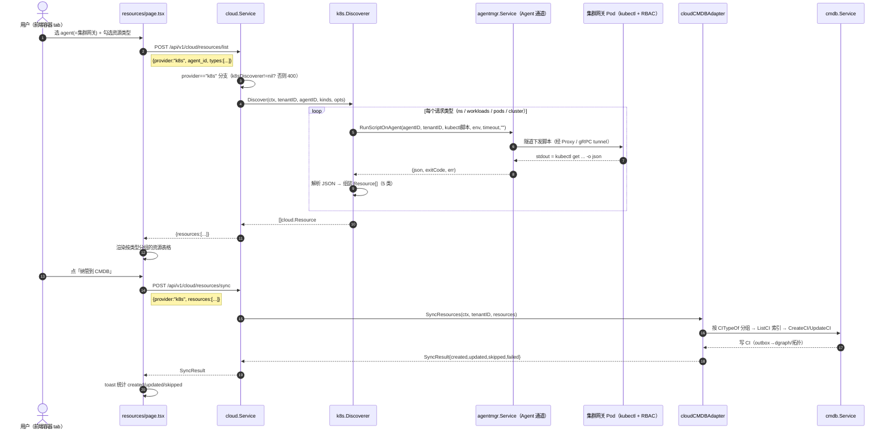
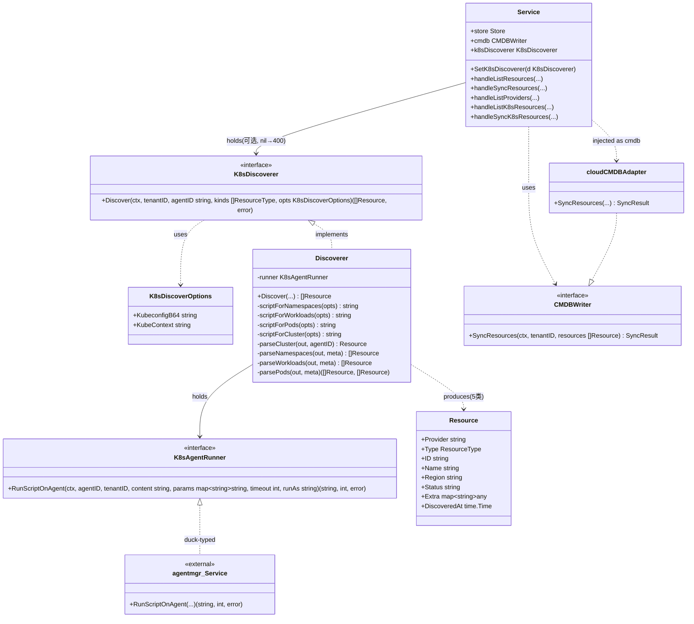

# OpsOrigin K8s 容器资源纳管（接入方式 B：Agent 通道 / DaemonSet）设计文档

> 目标：把 K8s 集群的 `cluster / namespace / workload(Deployment·StatefulSet·DaemonSet) / pod / container(含镜像)` 五类资源，**经既有 Agent 隧道**发现并纳管进 CMDB，复用 `internal/cloud` 的 Resource/CMDB/Agent 通道范式。
> 接入方式：**B（Agent 通道）**——OpsOrigin Agent 以容器（推荐单副本 Deployment，见 §3）部署进目标集群，其 ServiceAccount 自带 list/get RBAC；Core 经 `RunScriptOnAgent` 下发 `kubectl get ... -o json`，回收 JSON 解析为 `Resource[]`。
> 范围：仅设计，不含实现。**MVP 不直连 K8s API Server**（私有集群常连不上），不触碰 `cloud.Provider`（那是 AK/SK 模型）。
> 原则：最小变更、不破坏现有主机 / vuln / cloud(cmdb) 流程；沿用 service/route/CMDB/Agent 通道范式；零新增第三方 Go 依赖、零新增前端依赖。

---

## 0. 现状核查结论（设计依据）

| 核查项 | 结论 / 插座位置 |
|------|------|
| `internal/cloud/types.go` | `ResourceType` 已有 `TypeK8sCluster="k8s_cluster"`（占位）；`Resource{Provider,Type,ID,Name,Region,Zone,Status,PublicIP,PrivateIP,Labels,Extra,DiscoveredAt}`；`Provider` 接口是 AK/SK 模型（`ListResources(cred Credential,...)`）。**K8s 不实现该接口**。 |
| `internal/cloud/service.go` | `Service{store Store; cmdb CMDBWriter}` + `RegisterRoutes(mux)`；`CMDBWriter.SyncResources(ctx, tenantID, []Resource) SyncResult`。 |
| `internal/cloud/http_resource.go` | `handleListResources` 先 `Exists(provider)`→`Get(provider)`→`p.ListResources`。`parseKinds` **只放行 vm/database/load_balancer**。`resolveCredential` 要求 AK/SK。→ 需为 k8s 开分支。 |
| `internal/cloud/http_credential.go` | `handleListProviders` **硬编码** `types=[vm,database,load_balancer]` 给所有 provider。→ 需改为「按 provider 报支持的 types」，并补虚拟 `k8s` 条目。 |
| `internal/cloud/http_sync.go` | `handleSyncResources` 同样 `if !Exists(provider)→400`；若 body 带 `Resources[]` 则直接 `cmdb.SyncResources`，否则先发现。→ k8s 需在前置 `Exists` 前开分支。 |
| `internal/cloud/cmdb_sync.go` | `CITypeOf` 对未知类型走 `"cloud_"+string(res.Type)` 兜底；`ToCIMapping` 把 `Resource` 拼成 `CIMapping`（自然键 `provider:type:id`）。→ 加 `CITypeK8s*` 常量 + 分支即可自动落 CI。 |
| `internal/cloud/registry.go` | `providers map[string]Provider` 注册表。**k8s 不注册**（非 Provider）。→ k8s 走 `provider=="k8s"` 特判，不经注册表。 |
| `internal/vuln/scanner_agent.go` | `AgentRunner` 接口 + `RunScriptOnAgent(ctx, agentID, tenantID, content, params map[string]string, timeout int, runAs string) (string,int,error)` 范式；单 agent 失败 `continue`。**K8s 照此范式**（鸭子类型，cloud 包自定最小接口，不 import vuln/agentmgr）。 |
| `internal/agentmgr/service.go:843` | `*agentmgr.Service.RunScriptOnAgent` 签名完全一致；**硬前提**：agent 必须有 `ProxyID`（经 Proxy 或直连 gRPC tunnel 回连 Core），否则 `cannot dispatch`。 |
| `cmd/core/main.go` | `cloudSvc := cloud.NewService(cloud.NewMemStore(), cloudCMDBAdapter{...})`；`agentSvc := agentmgr.NewService(...)`（行 227），`server.RegisterService(agentSvc)`（行 251）；vuln 用 `vulnSvc.SetAgentRunner(agentSvc)` 注入。→ K8s 仿 `SetAgentRunner` 注入。 |
| `cmd/core/cloud_adapter.go` | `cloudCMDBAdapter.SyncResources` 按 `CITypeOf` 分组 → `ListCI` 索引 → `CreateCI/UpdateCI(model.WeightDiscovery)`，经 outbox→dgraph/拓扑。**K8s 资源经同一条链路进 CMDB，无需新写**。 |
| `internal/cmdb/model/ci.go` | `CIModel{TypeID,TenantID,Name,Status,Attributes,Labels,Channel,...}`；`WeightDiscovery=30`。K8s 同步用同权重。 |
| 前端云 tab | `resources/page.tsx` 821–921 行是**真实实现**（凭证表单 + 类型多选 + 发现/纳管按钮 + 结果表格）——**容器 tab 镜像此 UI**。 |
| 前端容器 tab | `resources/page.tsx` 923–937 行是纯占位（「即将上线」+ K8s 虚框）。 |
| 前端复用点 | `stores/cloud.ts`（zustand，镜像 `agent.ts`）、`lib/cloud.ts`（`CloudResource`/`SyncResult`/`CLOUD_RESOURCE_TYPES`）、`useAgentStore().agents`（选 agent=集群网关）。 |

---

## 1. 总体架构

### 1.1 核心思路

- **K8s ≠ `cloud.Provider`**。它走 **Agent 通道**，凭证本质是「哪个 `agent_id` = 哪个集群」（可选 kubeconfig/context 放 `Extra`）。
- `cloud.Service` 增加一个**可选**的 `k8sDiscoverer K8sDiscoverer` 字段（由 `cmd/core` 注入 `*k8s.Discoverer`）。为**避免 import 环**，`k8s.Discoverer`（在 `internal/cloud/k8s/`）只 import `internal/cloud`（取 `Resource`/`ResourceType`/接口）；`cloud` 包**不 import `k8s` 包**，只持有一个在 `cloud` 包内定义的 `K8sDiscoverer` 接口。
- `cloud` 包内自定最小接口 `K8sAgentRunner`（签名与 `*agentmgr.Service.RunScriptOnAgent` 完全一致）——鸭子类型满足，无需 import `agentmgr`，零耦合。
- 发现五类资源：**一次遍历拿全**（ns / workloads / pods 三条 `kubectl get`；cluster 由 agent_id 派生 1 条；container 从 pods 的 `spec.containers[]` 派生）。JSON 直接进 `Resource[]`。
- 「纳管到 CMDB」→ `handleSyncResources` → `cloudCMDBAdapter.SyncResources` → 既有 `CreateCI/UpdateCI`→outbox→dgraph/拓扑。**链路完全复用**。

### 1.2 调用时序图（Mermaid）



---

## 2. 后端设计

### 2.1 `cloud.Service` 扩展（不破坏既有 AK/SK 路径）

新增字段与注入点（`internal/cloud/service.go`）：

```go
// K8sAgentRunner 经 Agent 通道在被管集群网关节点执行脚本（鸭子类型满足 *agentmgr.Service）。
// 签名与 agentmgr.Service.RunScriptOnAgent 完全一致，cloud 包不 import agentmgr。
type K8sAgentRunner interface {
    RunScriptOnAgent(ctx context.Context, agentID, tenantID, content string,
        params map[string]string, timeout int, runAs string) (string, int, error)
}

// K8sDiscoverer 是 k8s 资源发现器契约（由 internal/cloud/k8s 包实现）。
// 它不是 cloud.Provider——cloud 包只持有此接口，不持有具体实现，避免 import 环。
type K8sDiscoverer interface {
    Discover(ctx context.Context, tenantID, agentID string,
        kinds []ResourceType, opts K8sDiscoverOptions) ([]Resource, error)
}

// K8sDiscoverOptions 发现选项；kubeconfig/context 经 env 注入（非 CLI 参数）。
type K8sDiscoverOptions struct {
    KubeconfigB64 string // 可选：base64(kubeconfig)，MVP 默认空=用网关 Pod 的 SA
    KubeContext   string // 可选：指定 context；MVP 默认空=current-context
}

// K8sProviderName 虚拟 provider 名（不进 registry，特判处理）。
const K8sProviderName = "k8s"

type Service struct {
    store         Store
    cmdb          CMDBWriter
    k8sDiscoverer K8sDiscoverer // 可选；nil 时 k8s 发现/同步返回 400
}

func (s *Service) SetK8sDiscoverer(d K8sDiscoverer) { s.k8sDiscoverer = d }
```

> 说明：任务里提到的「`agentRunner K8sAgentRunner` 字段」概念上等价于本设计的 `k8sDiscoverer`——具体 `k8s.Discoverer` 内部持有 `cloud.K8sAgentRunner`（由 `cmd/core` 把 `*agentmgr.Service` 鸭子传入）。`cloud.Service` 自己不直持 runner，避免再引入一层；若团队更想要 `SetAgentRunner(r)` 直接 setter，`k8s.NewDiscoverer(r)` 的构造可平移到 `cmd/core` 完成（见 T04），Service 只需 `SetK8sDiscoverer`。

### 2.2 K8s 发现器（新包 `internal/cloud/k8s/`）

> **明确它不是 `cloud.Provider`**：它不注册进 `registry`，不被 `cloud.Get("k8s")` 取到；它是 `cloud.Service` 在 `provider=="k8s"` 时调用的独立 discoverer。

`internal/cloud/k8s/k8s.go` 结构：

```go
package k8s

import "github.com/opsorigin/core/internal/cloud"

type Discoverer struct {
    runner cloud.K8sAgentRunner // 实为由 cmd/core 注入的 *agentmgr.Service
}

func NewDiscoverer(runner cloud.K8sAgentRunner) *Discoverer { return &Discoverer{runner: runner} }

// Discover：对每个请求类型，经 Agent 通道下发对应 kubectl 脚本，回收 JSON 解析。
// 单类型失败仅记日志 continue（vuln 范式），返回已成功部分。
func (d *Discoverer) Discover(ctx context.Context, tenantID, agentID string,
    kinds []cloud.ResourceType, opts cloud.K8sDiscoverOptions) ([]cloud.Resource, error)

// 脚本构造：分类型。set -o pipefail；不回显密钥。
func scriptForNamespaces(opts) string // kubectl get namespaces -o json
func scriptForWorkloads(opts) string  // kubectl get deployments.apps,statefulsets.apps,daemonsets.apps -A -o json
func scriptForPods(opts) string       // kubectl get pods -A -o json
func scriptForCluster(opts) string    // kubectl cluster-info -o json; kubectl version -o json

// JSON 解析 → 组装 Resource（五类）。
func parseCluster(out string, agentID string) (cloud.Resource, error)
func parseNamespaces(out string, meta clusterMeta) []cloud.Resource
func parseWorkloads(out string, meta clusterMeta) []cloud.Resource
func parsePods(out string, meta clusterMeta) ([]cloud.Resource, []cloud.Resource) // 返回 pods + 派生的 containers
```

**脚本范式（安全）**：
```bash
#!/bin/bash
set -o pipefail
# kubeconfig 经 env 注入（如有），非命令行参数
if [ -n "$OPS_KUBECONFIG_B64" ]; then
  echo "$OPS_KUBECONFIG_B64" | base64 -d > /tmp/ops-kc.yaml
  export KUBECONFIG=/tmp/ops-kc.yaml
fi
[ -n "$OPS_KUBE_CONTEXT" ] && kubectl config use-context "$OPS_KUBE_CONTEXT" >/dev/null 2>&1
kubectl get namespaces -o json   # 仅 list/get，不回显密钥
```
- env（`params map[string]string`）由 `RunScriptOnAgent` 透传为 Agent 端执行环境：`OPS_KUBECONFIG_B64`、`OPS_KUBE_CONTEXT`。**绝不**把用户内容拼进命令行。
- 超时默认 `120s`（大集群 `kubectl get pods -A` 可能较慢），由 `Discover` 传入 `RunScriptOnAgent` 的 `timeout` 参数。

**五类 `Resource` 组装规则**（Provider 恒为 `"k8s"`；`Resource.ID` 用 path 风格，集群前缀保证跨集群唯一；`Extra` 透传拓扑字段）：

| 类型 | `ResourceType` | ID 规则 | `Name` | `Extra`（节选） |
|---|---|---|---|---|
| 集群 | `k8s_cluster` | `cluster=<name>`（回退 `agent:<agentID>`） | 集群名 | `agent_id`, `gateway_agent_id`, `server`, `k8s_version`, `current_context` |
| 命名空间 | `k8s_namespace` | `<cluster>/ns/<ns>` | ns 名 | `cluster`, `agent_id`, `status` |
| 工作负载 | `k8s_workload` | `<cluster>/ns/<ns>/wl/<kind>/<name>` | workload 名 | `cluster`, `namespace`, `kind`(Deployment/StatefulSet/DaemonSet), `replicas`, `images[]`, `agent_id`, `labels` |
| Pod | `k8s_pod` | `<cluster>/ns/<ns>/pod/<pod>` | pod 名 | `cluster`, `namespace`, `node`, `phase`(status), `pod_ip`, `owner_kind`, `owner_name`, `agent_id` |
| 容器 | `k8s_container` | `<cluster>/ns/<ns>/pod/<pod>/c/<container>` | container 名 | `cluster`, `namespace`, `pod`, `image`, `image_pull_policy`, `owner_kind`, `owner_name`, `ports[]`, `resources`, `agent_id` |

- **container 由 pod 派生**：遍历每个 pod 的 `spec.containers[]`（及可选 `initContainers[]`，见 §9 待确认），一条 container = 一条 `Resource`，`Extra.image` 来自 `container.image`。
- **cluster** 由 `scriptForCluster` 返回的 `cluster-info`/`version` 解析：取 `cluster` 名（如 `kubernetes` 或 context 名），未知则回退 `agent:<agentID>`。`agent_id` 永远记入 `Extra`，作为「哪个网关 agent = 哪个集群」的锚点。

### 2.3 `internal/cloud/types.go`：新增 `ResourceType` 常量

```go
const (
    // 已有：TypeK8sCluster ResourceType = "k8s_cluster"（复用，作为 cluster 条目）
    TypeK8sNamespace ResourceType = "k8s_namespace"
    TypeK8sWorkload  ResourceType = "k8s_workload"
    TypeK8sPod       ResourceType = "k8s_pod"
    TypeK8sContainer ResourceType = "k8s_container"
)
```
> **不**把 k8s 类型加进 `AllResourceTypes()`（那是给 AK/SK provider 迭代用的，k8s 非 Provider）。另提供 `func K8sResourceTypes() []ResourceType` 返回上述 5 类，供 `handleListProviders` 等使用。

### 2.4 `internal/cloud/cmdb_sync.go`：CMDB CI 类型映射

```go
const (
    CITypeK8sCluster    = "k8s_cluster"
    CITypeK8sNamespace  = "k8s_namespace"
    CITypeK8sWorkload   = "k8s_workload"
    CITypeK8sPod        = "k8s_pod"
    CITypeK8sContainer  = "k8s_container"
)

func CITypeOf(res Resource) string {
    switch res.Type {
    case TypeVM, TypeDatabase, TypeLoadBalancer: // 既有
    case TypeK8sCluster:    return CITypeK8sCluster
    case TypeK8sNamespace:  return CITypeK8sNamespace
    case TypeK8sWorkload:   return CITypeK8sWorkload
    case TypeK8sPod:        return CITypeK8sPod
    case TypeK8sContainer:  return CITypeK8sContainer
    }
    return "cloud_" + string(res.Type) // 默认兜底
}
```
> `ToCIMapping` 已把 `Provider/Type/Region/.../Extra` 透传为 CI attributes，K8s 的 `Extra`（含 `agent_id`/`image`/`owner_*`）天然进 CMDB，**无需改 `cloudCMDBAdapter`**。`cloudCMDBAdapter.SyncResources` 按 `CITypeOf` 分组、走 `CreateCI/UpdateCI(model.WeightDiscovery)`——链路完全复用。

### 2.5 `http_resource.go`：发现端点接入 k8s 分支

- `resourceListRequest` 增加 `AgentID string \`json:"agent_id"\`` 与可选 `K8s K8sDiscoverOptions \`json:"k8s,omitempty"\``。
- `handleListResources` **最前面**加特判（在 `Exists`/`Get` 之前）：
  ```go
  if req.Provider == cloud.K8sProviderName {
      s.handleListK8sResources(w, r, req); return
  }
  ```
  `handleListK8sResources`：`agent_id` 为空 → 400；`s.k8sDiscoverer==nil` → 400("k8s discovery not configured")；`kinds:=parseKinds(req.Types)`（已扩展 k8s 类型）；调 `Discover`；`writeJSON({resources})`。
- `parseKinds` 增加 `case TypeK8sCluster, TypeK8sNamespace, TypeK8sWorkload, TypeK8sPod, TypeK8sContainer:` 放行（不再只 vm/db/lb）。

### 2.6 `http_credential.go`：providers 改为「按 provider 报 types」

`handleListProviders` 改为：
- 对每个 `Names()`（AK/SK provider）报其支持类型（MVP 统一 `[vm,database,load_balancer]`，预留 per-provider 扩展）。
- **若 `s.k8sDiscoverer != nil`**，追加虚拟条目 `{name:"k8s", types: K8sResourceTypes()}`——前端据此知道 K8s 可用且支持 5 类。
> 这样 k8s 的「provider」只在 discoverer 被注入时才出现，避免空壳。

### 2.7 `http_sync.go`：同步端点接入 k8s 分支

`handleSyncResources` **最前面**加特判：
```go
if req.Provider == cloud.K8sProviderName {
    s.handleSyncK8sResources(w, r, req); return
}
```
`handleSyncK8sResources`：`s.k8sDiscoverer==nil` → 400；若 `req.Resources` 非空（前端已发现后直接带上来）→ 直接 `s.cmdb.SyncResources(ctx, tenantID, req.Resources)`；若为空且带了 `agent_id`+`types` → 可经 discoverer 重新发现再同步（MVP 前端走「先发现再带 resources 同步」，故主路径是前者）。返回 `SyncResult`。

### 2.8 安全要点

- 下发脚本 `set -o pipefail`、仅 list/get，**不回显任何密钥**；kubeconfig 经 env（`params`）注入，绝不当 CLI 参数。
- 网关 Pod 的 RBAC 仅 `get/list/watch` 命名空间与三类 workload 与 pods（只读），见 §5。
- `agent_id` 来自请求体（代表目标集群网关）；`RunScriptOnAgent` 会校验 agent 存在且已绑定 Proxy——非法/未连 agent 直接报错，无越权。
- 审计：发现/同步走既有 auth→audit→rbac 中间件；`agent_id` 记入审计上下文即可，无需特殊处理密钥。

---

## 3. 多集群模型

- **每个 K8s 集群 = 一个 `agent_id`（网关 Pod）**。前端下拉选 agent 即选集群（`useAgentStore().agents`）。
- 部署形态取舍：
  - **❌ 不推荐全 DaemonSet（每节点一个 agent）**：会产生 N 个 agent_id，且「哪个是集群网关」模糊，发现只需 1 个有集群权限的 Pod。
  - **✅ 推荐：每集群一个单副本 `Deployment`（1 个网关 Pod）**（`opsorigin-k8s-gateway`，1 replica）。它带 RBAC、含 kubectl、经 Proxy/直连 tunnel 回连 Core。1 agent = 1 集群，语义清晰。
  - 若坚持 DaemonSet：需额外「选主 / 固定 nodeSelector」保证只 1 个 Pod 作网关，复杂度高，不建议 MVP 做。
- 网关 Pod 的 agent 必须已连 Core（`ProxyID` 非空）——否则 `RunScriptOnAgent` 拒绝派发（agentmgr 硬前提）。部署清单见 §5。
- 集群名来源：取 `kubectl config current-context` / `cluster-info` 的集群名；多 context 场景 MVP 只认 current-context（见 §9 待确认 7）。

---

## 4. 前端改造（`web-next/`）

### 4.1 `lib/cloud.ts`：新增 K8s 类型选项
```ts
export const K8S_RESOURCE_TYPES = [
  { value: 'k8s_cluster',    label: '集群' },
  { value: 'k8s_namespace',  label: '命名空间' },
  { value: 'k8s_workload',   label: '工作负载' },
  { value: 'k8s_pod',        label: 'Pod' },
  { value: 'k8s_container',  label: '容器' },
] as const
```
> `CloudResource` / `SyncResult` 类型**直接复用**，K8s 的 `provider:"k8s"`、各 `type`、嵌套字段走 `extra` 即可，无需新类型。

### 4.2 `stores/cloud.ts`：新增 K8s 方法（镜像既有）
```ts
discoverK8s: (data: { agent_id: string; types: string[]; kubeconfig?: string; kube_context?: string })
  => Promise<CloudResource[]>
syncK8s: (data: { agent_id: string; types: string[]; resources: CloudResource[] })
  => Promise<SyncResult | null>
```
内部走 `apiFetch('/cloud/resources/list'|'/cloud/resources/sync', {method:'POST', body: JSON.stringify({provider:'k8s', ...data})})`，失败 toast，与 `listResources`/`syncToCMDB` 同风格。

### 4.3 `resources/page.tsx`：容器 tab（923–937 行）由占位改为真实

**镜像云 tab（821–921）的 UI 范式**，三处差异：把「凭证表单」换成「**选 agent = 选集群**」；表格列适配 K8s 拓扑；纳管后 toast `created/updated/skipped`。

结构（示意，非实现）：
1. 左栏：
   - **目标集群（Agent）**下拉：`useAgentStore().agents`（`{id,name,type,status}`），label 显示 `name (id前8位)`；选中存 `k8sAgentID`。
   - **资源类型（多选）**：`K8S_RESOURCE_TYPES` 复选框，存 `k8sTypes`。
   - 按钮：`发现资源`（disabled 当未选 agent 或未勾类型）→ `discoverK8s({agent_id, types})`；`纳管到 CMDB`（disabled 当无结果/同步中）→ `syncK8s({agent_id, types, resources})` 后 toast 统计。
2. 右栏：
   - 「已发现 N 个资源」+ 按类型分组的表格（列：**类型 / 名称 / 集群 / 命名空间 / 状态 / 详情**（镜像或节点，取自 `extra`））。
   - 空态提示：「选择集群与资源类型，点击『发现资源』」。
3. K8s 容器纳管**是唯一目标**——在容器 tab 内仅展示 K8s 资源发现与纳管能力。

---

## 5. Agent 安装侧硬前提（部署清单，非 cloud 包代码）

> 属部署侧改动（新增 manifest），但必须点名——没有它，Agent 通道拿不到集群数据。

**硬前提清单**：
1. 容器 Agent 镜像**内含 `kubectl`**（及可选 `kubectl-convert`）；已有 `os=container` 安装脚本需出一个 K8s 原生变体（或新 `os=k8s`）。
2. 网关 Pod 用专用 **ServiceAccount** + **ClusterRole（只读）** + ClusterRoleBinding，仅 `get/list/watch`：
   - `namespaces`
   - `deployments.apps`, `statefulsets.apps`, `daemonsets.apps`（含 `-A` 跨命名空间）
   - `pods`（读 `spec.containers` 需 pods 的 get/list）
   - 可选 `nodes`/`events` 用于拓扑/状态富化（MVP 非必需）
3. 网关 Pod 的 Agent **必须回连 Core**（经 Proxy 或直连 gRPC tunnel，`ProxyID` 非空）。

**最小 RBAC + Deployment 片段（参考）**：
```yaml
apiVersion: v1
kind: ServiceAccount
metadata: { name: opsorigin-k8s-gateway, namespace: opsorigin }
---
apiVersion: rbac.authorization.k8s.io/v1
kind: ClusterRole
metadata: { name: opsorigin-k8s-readonly }
rules:
  - apiGroups: [""]
    resources: ["namespaces", "pods"]
    verbs: ["get", "list", "watch"]
  - apiGroups: ["apps"]
    resources: ["deployments", "statefulsets", "daemonsets"]
    verbs: ["get", "list", "watch"]
---
apiVersion: rbac.authorization.k8s.io/v1
kind: ClusterRoleBinding
metadata: { name: opsorigin-k8s-readonly }
roleRef: { apiGroup: rbac.authorization.k8s.io/v1, kind: ClusterRole, name: opsorigin-k8s-readonly }
subjects:
  - kind: ServiceAccount
    name: opsorigin-k8s-gateway
    namespace: opsorigin
---
apiVersion: apps/v1
kind: Deployment
metadata: { name: opsorigin-k8s-gateway, namespace: opsorigin }
spec:
  replicas: 1
  selector: { matchLabels: { app: opsorigin-k8s-gateway } }
  template:
    metadata: { labels: { app: opsorigin-k8s-gateway } }
    spec:
      serviceAccountName: opsorigin-k8s-gateway
      containers:
        - name: agent
          image: opsorigin/agent:latest   # 内置 kubectl
          # env: 注入 OPSORIGIN_SERVER / PROXY / TUNNEL 令牌，使其回连 Core
```

---

## 6. 文件清单（相对路径）

后端（新增 / 修改）：
- `internal/cloud/types.go` — 改：新增 `TypeK8sNamespace/Workload/Pod/Container` 常量 + `K8sResourceTypes()`。
- `internal/cloud/service.go` — 改：新增 `K8sAgentRunner` / `K8sDiscoverer` 接口、`K8sDiscoverOptions`、`K8sProviderName`、`Service.k8sDiscoverer` 字段、`SetK8sDiscoverer`。
- `internal/cloud/k8s/k8s.go` — **新**：`Discoverer` + 脚本构造 + JSON 解析 + 五类 `Resource` 组装 + `NewDiscoverer`。
- `internal/cloud/cmdb_sync.go` — 改：新增 `CITypeK8s*` 常量 + `CITypeOf` 分支。
- `internal/cloud/http_resource.go` — 改：`resourceListRequest` 加 `agent_id`/`k8s`；`handleListResources` k8s 分支；`parseKinds` 放行 k8s。
- `internal/cloud/http_credential.go` — 改：`handleListProviders` 按 provider 报 types + 虚拟 k8s 条目。
- `internal/cloud/http_sync.go` — 改：`handleSyncResources` k8s 分支。
- `cmd/core/main.go` — 改：import `internal/cloud/k8s`；在 `server.RegisterService(agentSvc)` 之后 `cloudSvc.SetK8sDiscoverer(k8s.NewDiscoverer(agentSvc))`。

前端（新增 / 修改）：
- `web-next/src/lib/cloud.ts` — 改：新增 `K8S_RESOURCE_TYPES`。
- `web-next/src/stores/cloud.ts` — 改：新增 `discoverK8s` / `syncK8s`。
- `web-next/src/app/(dashboard)/resources/page.tsx` — 改：容器 tab（923–937）由占位改为真实 K8s UI（agent 下拉 + 类型多选 + 发现/纳管 + 分组表格）。

部署侧（新增，非 cloud 包）：
- `deploy/k8s/opsorigin-k8s-gateway.yaml` — **新**：SA + ClusterRole + ClusterRoleBinding + 单副本 Deployment（含 kubectl 的 agent 镜像）。

---

## 7. 数据结构 / 接口草图

> 完整 Mermaid 类图见文末 §附录A。

关键 Go 类型（草图）：
```go
// ---- cloud 包内定义（契约），k8s 包实现 ----
type K8sAgentRunner interface {
    RunScriptOnAgent(ctx context.Context, agentID, tenantID, content string,
        params map[string]string, timeout int, runAs string) (string, int, error)
}
type K8sDiscoverer interface {
    Discover(ctx context.Context, tenantID, agentID string,
        kinds []ResourceType, opts K8sDiscoverOptions) ([]Resource, error)
}
type K8sDiscoverOptions struct { KubeconfigB64, KubeContext string }

// ---- internal/cloud/k8s 包 ----
type Discoverer struct { runner cloud.K8sAgentRunner }
func NewDiscoverer(runner cloud.K8sAgentRunner) *Discoverer
func (d *Discoverer) Discover(...) ([]cloud.Resource, error)

// kubectl JSON 解析结构（最小化，按需扩展）
type k8sObjectMeta struct {
    Name        string            `json:"name"`
    Namespace   string            `json:"namespace"`
    Labels      map[string]string `json:"labels"`
    OwnerReferences []struct {
        Kind string `json:"kind"`; Name string `json:"name"`
    } `json:"ownerReferences"`
}
type k8sContainer struct {
    Name            string `json:"name"`
    Image           string `json:"image"`
    ImagePullPolicy string `json:"imagePullPolicy"`
    Ports           []struct{ ContainerPort int32 `json:"containerPort"`; Protocol string `json:"protocol"` } `json:"ports"`
    Resources       any    `json:"resources"`
}
type k8sPodSpec struct {
    NodeName  string          `json:"nodeName"`
    Containers []k8sContainer `json:"containers"`
    InitContainers []k8sContainer `json:"initContainers"`
}
type k8sPod struct {
    Metadata k8sObjectMeta `json:"metadata"`
    Spec     k8sPodSpec   `json:"spec"`
    Status   struct { Phase string `json:"phase"`; PodIP string `json:"podIP"` } `json:"status"`
}
type k8sPodList struct { Items []k8sPod `json:"items"` }
// workloads / namespaces 解析结构类似（items 含 metadata + workload 特定 spec.replicas）
```

---

## 8. 有序任务列表（T01–T07，按实现顺序）

| ID | 任务 | 源文件 | 依赖 | 优先级 |
|----|------|--------|------|--------|
| **T01** | 类型与 CMDB 映射底座：新增 `TypeK8s*` 常量 + `K8sResourceTypes()`；`cmdb_sync.go` 加 `CITypeK8s*` 常量 + `CITypeOf` 分支（让 K8s 自动落 CI）。 | `internal/cloud/types.go`, `internal/cloud/cmdb_sync.go` | 无 | P0 |
| **T02** | K8s Agent 通道发现器：实现 `internal/cloud/k8s` 包——`Discoverer` + 脚本构造（`set -o pipefail`、env 注入 kubeconfig）+ JSON 解析 + 五类 `Resource` 组装（cluster 派生、container 从 pod 派生）。 | `internal/cloud/k8s/k8s.go`（新） | T01 | P0 |
| **T03** | cloud 服务接入 k8s 分支：`service.go` 加接口/字段/`SetK8sDiscoverer`；`http_resource.go`（`resourceListRequest` 加 `agent_id`、k8s 分支、`parseKinds` 放行）；`http_credential.go`（按 provider 报 types + 虚拟 k8s）；`http_sync.go`（k8s 分支）。 | `internal/cloud/service.go`, `internal/cloud/http_resource.go`, `internal/cloud/http_credential.go`, `internal/cloud/http_sync.go` | T01, T02 | P0 |
| **T04** | `cmd/core` 注入发现器：import `internal/cloud/k8s`；在 `server.RegisterService(agentSvc)` 之后 `cloudSvc.SetK8sDiscoverer(k8s.NewDiscoverer(agentSvc))`。 | `cmd/core/main.go` | T02, T03 | P0 |
| **T05** | 前端类型与 store：新增 `K8S_RESOURCE_TYPES`；`discoverK8s` / `syncK8s` 方法。 | `web-next/src/lib/cloud.ts`, `web-next/src/stores/cloud.ts` | T03（定 API 契约） | P1 |
| **T06** | 前端容器 tab 改造：占位 → 真实 K8s UI（agent 下拉选集群 + 类型多选 + 发现/纳管按钮 + 按类型分组表格 + 纳管 toast 统计）。 | `web-next/src/app/(dashboard)/resources/page.tsx` | T05 | P1 |
| **T07** | Agent 安装侧硬前提：出 K8s 网关部署 manifest（SA + 只读 ClusterRole + ClusterRoleBinding + 单副本 Deployment，agent 镜像含 kubectl，回连 Core）。可并行启动。 | `deploy/k8s/opsorigin-k8s-gateway.yaml`（新） | 无（部署侧，与 T01+ 并行） | P0 |

> 顺序逻辑：T01→T02→T03 是后端链路（底座→发现器→接入）；T04 仅装配；T05→T06 是前端（依赖后端契约稳定）；T07 是部署硬前提，可与后端并行，但 UAT 前必须就绪。

---

## 9. 依赖包（多已存在）

- **Go**：仅标准库 `encoding/json`、`context`、`strings`、`fmt`、`log/slog`、`time`。**零新增第三方 Go 依赖**（kubectl 在被管网关节点执行，Core 侧只做 JSON 解析）。
- **前端**：复用现有 Next.js/React + MUI + zustand + 既有 `apiFetch`/`toast`/表格组件。**零新增 npm 依赖**。
- 既有被复用：vuln `AgentRunner` 范式、`cloudCMDBAdapter.SyncResources`、`cmdb.CreateCI/UpdateCI`、outbox/dgraph/拓扑。

---

## 10. 共享约定

- **统一响应**：沿用 cloud 现有 `writeJSON`/`writeError`（统一 JSON），租户取 `ctx.Value("tenant_id")`，默认 `"default"`。
- **Agent 通道铁律**：绝不把用户内容拼进命令行；敏感项（kubeconfig）经 `params` env 注入。
- **资源 ID**：path 风格 `<cluster>/ns/...`，集群前缀保证跨集群唯一；CMDB 自然键 = `provider:type:id`（由 `cloud.CITypeOf`/`ToCIMapping` 生成）。
- **失败容错**：单类型 / 单 agent 失败仅记日志 `continue`（vuln 范式），返回已成功部分。
- **时间**：`DiscoveredAt` 用 UTC。
- **同步权重**：K8s 资源经 `model.WeightDiscovery`（=30）写入，受 anti-flapping 保护（人工改过的 CI 不被自动覆盖 → 计 `skipped`）。

---

## 11. 待确认问题（需用户拍板）+ 我的建议

| # | 待确认问题 | 我的建议（MVP 范围 / 延后项） |
|---|-----------|------------------------------|
| 1 | **kubeconfig / context 覆盖**是否 MVP 做？ | **MVP 不做 UI**，仅预留 env 注入 hook（§2.2）。MVP 一律用网关 Pod 的 SA（in-cluster）。多 context / 远端 kubeconfig 接管列为 P1。 |
| 2 | **workload 是否含 Job / CronJob**？ | **MVP 仅 Deployment / StatefulSet / DaemonSet**（用户已拍板范围）。Job/CronJob 延后（其 pods 归属语义不同，ownerRef 为 `Job`）。 |
| 3 | **container 是否展开 `initContainers`**？ | **MVP 仅 `spec.containers`（regular）**。`initContainers` 建议延后或单独标记为 `k8s_container(init)` 类型（避免与 regular 混淆）。请确认是否一并纳管。 |
| 4 | **CMDB 是否需预注册 `k8s_*` 五类 CI 类型 schema**？ | 需确认 `cmdb.CreateCI` 对未知 `TypeID` 的行为：若要求类型先定义，则需补 seed/迁移注册 5 类 `CIModelType`（schema 可先用宽松 `attributes` 透传）。**这是 K8s 资源能否落 CMDB 的硬前提，建议 T01 同步确认**。 |
| 5 | **前端如何识别「哪些 agent 是 K8s 网关」**？ | **MVP 简单方案**：容器 tab 直接列出 `useAgentStore().agents` 全部 agent 作为候选集群（label 显示 name+类型）。长期：agent 安装 K8s manifest 时打 `type:"k8s"`，前端据此过滤。请确认 MVP 用「全量 agent 候选」还是「按 type 过滤」。 |
| 6 | **多集群部署形态**：单 Deployment(1) vs DaemonSet 选主？ | **推荐单副本 Deployment**（§3）。DaemonSet 选主复杂度高，不建议 MVP。 |
| 7 | **集群名来源**：多 context 取哪个？ | MVP 取 `current-context` / `cluster-info` 集群名；多 context 指定留待 kubeconfig 覆盖（#1）一并做。 |
| 8 | **大集群性能 / 超时**：`kubectl get pods -A` 可能很大 | MVP 单次调用 + 默认 `timeout=120s`，不做分页；超大集群分页/增量（watch）列为后续优化。 |

### MVP 范围一句话
> 单副本网关 Deployment + 只读 RBAC + Agent 通道，发现 **cluster/namespace/workload(Deploy/STS/DS)/pod/container(regular)** 五类并一次纳管进 CMDB；in-cluster SA，无 kubeconfig UI，不含 Job/CronJob、不含 initContainers（除非确认）。

---

## 附录 A：类图（Mermaid）



## 附录 B：序列图（同 §1.2，便于单独导出）

> 见 §1.2 的 `sequenceDiagram` 块（可整段复制为 `k8s-sequence.mermaid`）。
