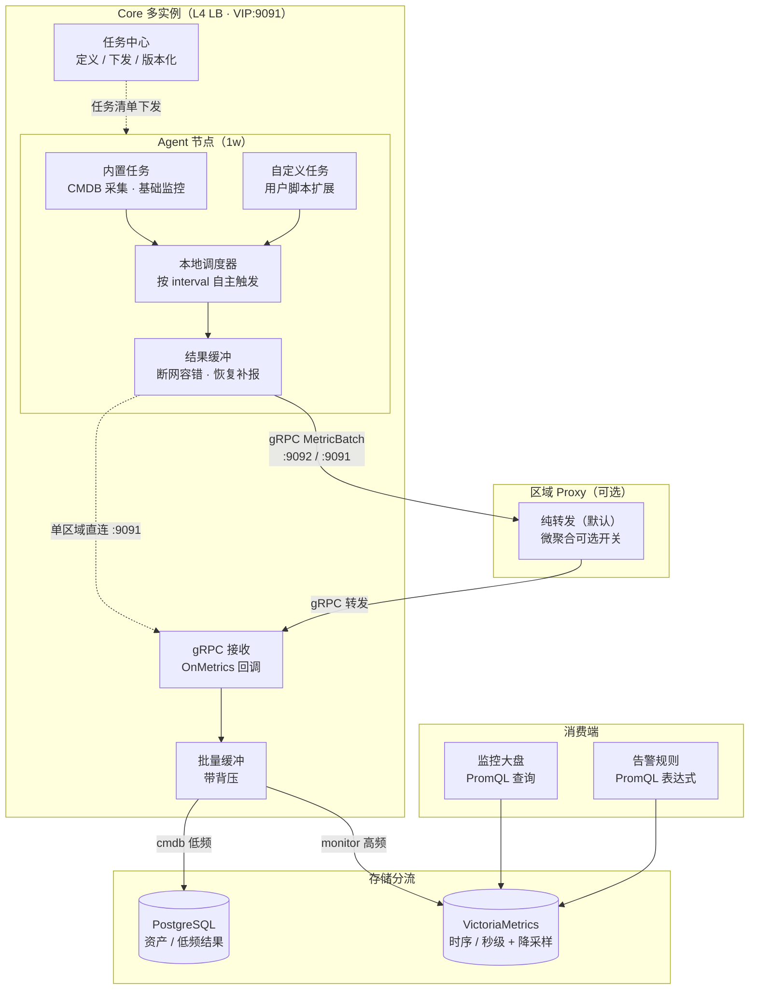

# OpsOrigin 监控数据管道与横向扩展 — 需求与架构设计文档

> 状态：评审稿 v1 | 日期：2026-08-01 | 来源：架构讨论纪要
> 范围：1w 主机节点规模的监控秒级上报、CMDB 低频采集、Server 多实例高可用

---

## 1. 背景与目标

OpsOrigin 目标承载 **1w 台被管主机节点**。规模化的两个核心挑战：

1. **监控数据**：Agent 需**秒级、多维度**上报（CPU 各核/内存/磁盘/网络/进程等），这是全新量级的数据管道
2. **服务可用性**：Server 接收端需多实例部署，单节点故障不能导致数据上报中断

同时确认：**CMDB/资产类数据为低频采集（30s~1min 一次）**，与监控数据是两条完全不同的管道。

**本需求的目标架构**：数据面分流（监控走时序库、CMDB 走 PG）+ Agent 上报走 gRPC 数据面通道 + Server 多实例 L4 负载均衡。**不引入服务注册中心**（详见 §7）。

## 2. 现状盘点（已具备的基础）

| 能力 | 现状 | 说明 |
|------|------|------|
| 存储注入 | ✅ 已打通 | audit/monitor/itsm/agentmgr/knowledge 均支持 `db`/`rdb` 注入，配好 PG/Redis 即持久化 |
| 健康检查 | ✅ 已强化 | `/healthz`(liveness) `/readyz`(readiness) `/api/v1/health`(兼容)，含 instance_id/uptime |
| gRPC 隧道 | ✅ 已存在 | `api/proto/tunnel.proto` 双向流（register/heartbeat/command/forward），支持 mTLS+token |
| Prometheus 生态 | ✅ 已内置 | `/metrics` + promhttp |
| 采集任务 | ✅ 已有 | agentmgr collect 任务（默认 60s 间隔，走 PG collect_metrics）——定位为低频/CMDB 类 |
| **监控秒级上报** | ❌ 缺失 | **无 Agent 秒级上报入口**（无 ingest/report 端点），本需求核心新增项 |

## 3. 需求分析

### 3.1 功能需求

| 编号 | 需求 | 优先级 |
|------|------|--------|
| FR-1 | Agent 秒级采集主机指标（CPU/内存/磁盘/网络/进程等多维度），**本地调度、自主执行、批量上报** | P0 |
| FR-2 | 上报通道走 gRPC 数据面通道（复用/扩展 tunnel.proto），**不走 HTTP API** | P0 |
| FR-3 | 多区域拓扑：Agent → 区域 Proxy → Core；单区域拓扑：Agent 直连 Core（同一套协议） | P0 |
| FR-4 | Core 接收后批量写入时序库（推荐 VictoriaMetrics），支持监控大盘查询 | P0 |
| FR-5 | 告警规则基于时序查询（PromQL 表达式），如 `avg(cpu_usage) by(host) > 90` | P1 |
| FR-6 | CMDB/资产低频采集（30s~1min）与监控**共用同一套任务模型**（见 §4.7），低频结果走 PG | P0 |
| FR-7 | Server 接收端多实例 + L4 负载均衡，单实例故障自动摘除、Agent 自动重连 | P0 |
| FR-8 | 时序数据保留策略 + 降采样（秒级保留短周期、分钟级长周期） | P1 |
| FR-9 | **内置任务（Agent 打包）**：装机自带「基础 CMDB 采集」+「基础监控」，开箱即用；参数可调、可禁用 | P0 |
| FR-10 | 任务清单**版本化 + 增量下发**：Server 定义任务 → 下发 → Agent 同步；任务变更仅下发增量 | P1 |
| FR-11 | **自定义任务**：用户通过 UI/API 定义（脚本类型，shell/python），指定目标 Agent 下发，含启停/删除生命周期 | P0 |

### 3.2 非功能需求

- **时效**：端到端延迟 ≈ Agent 上报周期 + 网络 + 写入（秒级场景目标 < 3s）；Proxy 不引入额外聚合延迟
- **吞吐**：1w 节点 × 5s 间隔 × 30 维度 ≈ **6w 指标点/s**；1s 间隔 × 50 维度 ≈ **50w 点/s**
- **可用性**：任一 Server 实例故障不影响上报；Agent 断线自动重连（指数退避 + 抖动）
- **存储**：监控数据与业务数据（PG）物理隔离，互不影响

## 4. 架构设计

### 4.0 总体架构图



**图例说明**：
- **Agent**：内置任务（CMDB 采集/基础监控）+ 自定义任务 → 本地调度器自主执行 → 结果缓冲（断网不丢）→ gRPC 主动上报
- **通道**：多区域经 Proxy（纯转发）汇聚，单区域直连 Core；统一 tunnel.proto 扩展（`MetricBatch`）
- **Core**：任务中心只管"定义/下发"（任务归任务）；gRPC 接收 + 批量缓冲后**按任务类型分流**（上报归上报）
- **存储**：低频 cmdb → PG；高频 monitor → VM（降采样 + 保留策略）
- **消费**：监控大盘与告警均以 PromQL 查询 VM，与业务库 PG 物理隔离

### 4.1 总体原则

```
1) 不引入服务注册中心(Consul/Nacos/Etcd):
   单体多实例 + L4 LB + 无状态实例 + 健康检查即可;
   K8s 场景用原生 Service+HPA; 自建注册中心仅在裸机多进程动态扩缩容场景才需要。

2) 数据面分流:
   监控(高频秒级) --> 时序库 VM
   CMDB/业务(低频) --> PostgreSQL
```

### 4.2 拓扑（两种形态，同一套协议）

```
多区域:  Agent × N ──gRPC(:9092)──> 区域 Proxy ──gRPC(:9091)──> Core ──批量──> VM
单区域:  Agent × 1w ──gRPC(:9091)──> Core(直连) ──批量──> VM
```

- Proxy 按区域天然分摊连接（单 Proxy 数百~数千 Agent），区域多则 Proxy 多，水平扩展自动发生
- 单区域无 Proxy 时 Agent 直连 Core（Core 单机可扛 5-10w 长连接）

### 4.3 Agent 上报通道（gRPC，扩展 tunnel.proto）

```
// tunnel.proto 扩展（字段号避开已用 10/20/30/40）
message MetricPoint {
  string name = 1;                  // 如 cpu.usage / mem.used
  double value = 2;
  map<string,string> labels = 3;    // 维度: core/disk/mount...
}
message MetricBatch {
  int64 timestamp = 1;
  repeated MetricPoint points = 2;  // 一次上报多维度
}
// TunnelMessage.oneof 新增: MetricBatch metrics = 50;
```

**选型理由（vs HTTP ingest）**：复用已有长连接（1w Agent 已连着）、protobuf 二进制（比 JSON 小 3-5x）、HTTP/2 多路复用（指标流/心跳/命令互不阻塞）、双向（可实时下发采集配置变更）。

### 4.4 Proxy 转发策略：默认纯转发 + 可选微聚合

| 模式 | 行为 | 时效 | 适用 |
|------|------|------|------|
| **纯转发（默认）** | 收到 MetricBatch 立即转发 Core，零延迟、无状态 | 无额外延迟 | 所有场景 |
| 微聚合（配置开关，默认关） | 500ms~1s 窗口合并**同 Agent 同 metric+labels** 的重复点 | 损失 ≈ 窗口大小 | 仅 Core 写入吞吐吃紧时 |

- 关键认知：**HTTP/2 多路复用已实现"连接汇聚"**（Core 只面对区域数条连接），纯转发不丢架构红利
- 聚合窗口延迟损失上限 = 窗口大小；Agent 上报间隔越小越伤时效（1s 上报 + 1s 窗口 = 吃掉 100% 周期）→ 默认不聚合
- 微聚合只做"同序列去重合并"，**不做跨 Agent 求均值/降维**（保留原始粒度，保排障能力）
- 核心批量写入在 Core 侧内存缓冲 + 定时 flush（吞吐优化，不增加网络时效）

### 4.5 时序存储选型：VictoriaMetrics（推荐）

| 方案 | 写入吞吐 | 查询 | 契合度 | 结论 |
|------|---------|------|--------|------|
| **VictoriaMetrics** | 单机 100w+ 点/s | PromQL | ✅ 项目已内置 /metrics+promhttp；单二进制、低资源 | **推荐** |
| TimescaleDB | ~10-50w 点/s | SQL | 复用 PG 但抢资源、无 PromQL | 备选 |
| Prometheus 单机 | 30w 序列上限 | PromQL | 无长期存储（15 天）、push 模型不符 | 不单独用 |
| PG 普通表 | 1-5w 行/s | SQL | 只有需求的 1/10-1/100 | 排除 |

- **VictoriaMetrics 王牌**：原生降采样（秒级留 7 天 → 分钟级留 30 天 → 小时级留 1 年），52 亿条/天原始数据实际存储 1/60
- 查询/告警入口：PromQL（`avg(cpu_usage) by(host) over 1h`）

### 4.6 Server 多实例高可用

```
Agent ──gRPC──> VIP:9091 ──L4 LB(Nginx stream/HAProxy/K8s Service)──> Core 实例 A/B/C
                                                                    └──> VM/PG/Redis(共享)
```

**要点**：
1. **gRPC 长连接固定在单实例**（HTTP/2 内不轮询请求）——轮询发生在连接建立时；监控数据无状态，落到哪个实例都行
2. **L4 TCP LB 足够**（无需 L7 gRPC 代理）；实例故障 → LB 摘除 → Agent 断线重连自动落健康实例
3. **重连风暴防护**：gRPC 客户端自带指数退避 + 抖动；Agent 侧再加 0-5s 随机抖动
4. **命令通道会话亲和**：会话状态存 Redis（共享）或 Core 内维护 agent→instance 映射
5. **健康检查**：L4 用 TCP 探活 `:9091`；后续补 gRPC 标准 health service（`grpc.health.v1.Health`）与 HTTP healthz/readyz 互补

### 4.7 任务生命周期模型：任务归任务、上报归上报（核心决策）

**原则**：Server 只负责**定义与下发任务**；Agent 拿到任务清单后**本地自主调度执行**，无论 CMDB 数据还是监控数据，**统一走"本地执行 + 主动上报"**逻辑。Server 不再逐轮派发脚本（替代现有 DueTasks 轮询派发模式）。

```
Server 任务中心 --任务定义(类型/周期/脚本/目标)--> Agent 任务清单(版本化)
                                                  │
                                     Agent 本地调度器按各自周期触发
                                                  │
              ┌──────────────┬────────────────────┴───────────────┐
        cmdb 任务(30s~1min)   monitor 任务(1~5s)          默认任务(装机自带)
              └──────────────┴────────────────────┬───────────────┘
                                     Agent 主动上报(gRPC 统一通道)
                                                  │
                             Core 分流: 低频→PG | 高频→VM
```

### 4.7.1 上报 QoS 语义：监控即时上报，CMDB 可缓存（核心决策）

**原则**：监控数据是"当下状态快照"，**晚到即失真**——必须即时上报；"上报断流"本身就是故障信号。CMDB 数据弱时效，可本地缓存。

| 维度 | monitor（监控） | cmdb（资产） |
|------|----------------|-------------|
| 上报 | **即时**：仅毫秒~秒级凑批（gRPC 一帧多带点），**不做断线缓存** | 可延迟、批量 |
| 断线 | **丢弃新点**（数据已过期，补传无意义还占带宽/存储） | 本地缓存，重连**补传快照** |
| 断流语义 | **故障信号**：Core 按 interval_sec 估算上报节奏，超过 N 周期未收到 → **no_data 告警** | 正常容忍 |
| 恢复后 | **只报当前点**，不补历史 | 先补最新快照（增量/全量） |
| 采集器 | 独立于上报器持续运行（1~5s），与网络状态无关 | 同左 |

**要点**：
1. **"凑批"≠"缓存"**：监控缓冲只为降低包数（如 200ms 一帧），断网即弃，绝不落盘
2. **两种"没数据"要区分**：Agent 存活但采集失败 → 发状态/心跳消息（"alive but no data"）；完全断流 → 网络/节点故障。服务端据此区分告警类型
3. **服务端 no_data 检测**：阶段 4 告警 PromQL 化的前置能力（`absent(metric)` 或 interval 超时判定）
4. **实现含义**：阶段 1 Buffer 背压丢弃已符合监控语义 ✅；阶段 3 Agent 侧按 task_type 走两套上报路径（monitor 即时无缓存 / cmdb 缓存补传）

**要点**：
1. **任务即配置**：`CollectTask` 模型可复用（type=cmdb|metric|monitor、script、interval_sec、target_agents），执行端从"Server 派发"迁移到"Agent 本地调度"
2. **本地调度**：Agent 按 interval_sec 自主触发（本地 cron 语义），执行时间点不受 Server 调度器和网络往返影响——1w 节点 × 秒级时 Server 调度压力归零，只面对上报流
3. **任务分类（内置 vs 自定义）**：
   - **内置任务**（Agent 打包内置，开箱即用）：① 基础 CMDB 采集（OS/CPU/内存/磁盘/网卡/软件等资产信息）② 基础监控（CPU/内存/磁盘/网络/进程，1~5s）。内置任务参数可被用户调优（如采集周期）、可禁用，但定义随 Agent 版本发布
   - **自定义任务**（用户通过 UI/API 定义）：脚本扩展（shell/python），指定目标 Agent（或按标签/分组），支持创建/启停/删除。输出按 type 解析：`cmdb`→资产 JSON 走 PG，`metric/monitor`→指标（可带 labels）走 VM
   - **Agent 任务清单 = 内置任务 + 用户自定义任务**（按 tenant/Agent 过滤后合并下发）；内置任务与自定义任务互不冲突，统一由本地调度器调度
4. **版本化**：任务清单带版本号，Agent 启动/心跳时同步；内置任务版本随 Agent 发布，自定义任务版本随 Server 下发（增量更新）
5. **统一上报通道**：CMDB 低频与监控高频共用 gRPC MetricBatch 通道，只是频率不同；Core 按任务类型分流存储（低频→PG agent_hosts/collect_metrics，高频→VM）
6. **断网容错**：Agent 本地调度不依赖在线，采集结果本地缓冲，恢复后补报

**与现有 collect_metrics 的演进关系**：现有"Server 调度派发"模式作为过渡保留（Agent 未升级时兼容）；新模型上线后，任务定义与结果存储复用，**调度职责迁移到 Agent 侧**。collect_metrics 继续承载低频任务结果（PG），监控高频进 VM（数据面分流不变）。

## 5. 容量估算（1w 节点）

| 层 | 负载 | 单实例容量 | 余量 |
|----|------|-----------|------|
| 控制面 API | ~100 QPS | ≥2,000 RPS | 20x+ |
| Agent 长连接 | 1w 连接（分散至各 Proxy/直连） | 单机 5-10w | 5-10x |
| 监控采集（5s×30 维度） | 6w 点/s → VM | VM 100w+ 点/s | 16x |
| 监控采集（1s×50 维度，上限） | 50w 点/s → VM | VM 100w+ 点/s | 2x |
| CMDB 采集（30s~1min） | ~1k 条/s → PG | PG 批插 1-5w/s | 10-50x |
| 存储 | 监控 52 亿条/天（降采样后 1/60）| VM 原生保留+降采样 | 可控 |

**结论**：1w 节点单体可撑（舒适区），瓶颈在存储层，由时序库方案解决；**不需要微服务化**。

## 6. 端口规范（澄清 5688 误记）

| 通道 | 配置项 | 默认端口 |
|------|--------|---------|
| Core HTTP API | `OPSNEXUS_CORE_ADDR` | :8080 |
| Proxy TCP tunnel | `OPSNEXUS_PROXY_LISTEN` | :9090 |
| **Core gRPC tunnel** | `OPSNEXUS_CORE_GRPC_LISTEN` | **:9091** |
| Proxy gRPC | `OPSNEXUS_PROXY_GRPC_LISTEN` | :9092 |

> 注：5688 从未是端口配置（仅出现在 tsconfig.tsbuildinfo 缓存数字中，已随该文件 gitignore）。

## 7. 技术边界：明确不引入的组件

### 7.1 服务注册中心（Consul/Nacos/Etcd）

| 场景 | 方案 |
|------|------|
| 单体多实例（现在） | L4 LB + 无状态实例 + healthz/readyz（✅ 已落地） |
| K8s 部署 | 原生 Service + Deployment + HPA（自带服务发现，无需自建） |
| 裸机多进程动态扩缩容 | 才考虑 Consul/Nacos（当前不适用） |
| OpsOrigin 自身定位 | 用自家监控体系纳管自身实例（吃自己的狗粮），轻量心跳注册即可 |

### 7.2 流处理引擎（Flink / Spark Streaming / Kafka Streams）

**不引入。** 数据链路是"写多算少"：写入为无状态转发 + 批量落库，聚合/降采样由时序库**查询时计算**（PromQL range 聚合、VM 原生降采样），告警为周期性 PromQL 查询评估——没有任何环节需要状态化流计算。

| 管道环节 | 处理模式 | 执行者 |
|---------|---------|--------|
| 写入 | 无状态转发 + 批量落库（过滤/清洗少量 Go 代码） | Core 进程 |
| 聚合/降采样 | 查询时聚合（PromQL / VM downsampling） | 时序库 |
| 告警评估 | 周期性 PromQL 查询（每 15s 评估规则） | 规则引擎 |
| 复杂告警关联 | PromQL `and / or / unless` 组合表达式 | 时序库 |

- 量级：峰值 50w 点/s，Go 单进程轻松处理；Flink 定位千万级事件 + 复杂状态，且引入需维护分布式集群（JM/TM/checkpoint/背压），成本远超收益
- 边界：仅当出现**毫秒级多指标时序关联（CEP）**或**在线指标计算**需求时才重新评估；届时优先 PromQL 表达式组合（覆盖 99% 场景），其次 Core 内轻量窗口聚合（几十行 Go），Flink 为最后选项

### 7.3 微服务化拆分

1w 节点单体可撑（容量见 §5），瓶颈在存储而非应用层；仅在节点 10w+ 或单实例连接 5w+ 时，按需拆分**连接层/采集层**为独立进程（同一套代码，独立监听），**不是微服务架构转型**。

## 8. 实施计划

| 阶段 | 内容 | 交付物 |
|------|------|--------|
| **阶段 1** | 协议扩展 + Core 接收 | tunnel.proto 加 MetricBatch；grpcserver 加 OnMetrics 回调；内存缓冲（带背压） |
| **阶段 2** | VM 时序库接入 | VM client + 批量写入 + 查询 API（监控大盘 PromQL 入口） |
| **阶段 3** | Agent 任务清单 + 本地调度 | 任务清单版本化下发；Agent 本地调度器；默认任务；**本地执行 + gRPC 主动上报**（替代 Server 逐轮派发，旧派发模式过渡保留） |
| 阶段 4（P1） | 告警 PromQL 化 | 规则引擎从 PG 轮询改为 VM PromQL 查询 |
| 阶段 5（可选） | 高可用收尾 | gRPC health service、会话亲和、重连抖动调优 |

## 9. 待决策项

1. **时序库确认**：默认推荐 VictoriaMetrics；若团队更熟 SQL 可换 TimescaleDB
2. **监控数据是否并入现有 collect_metrics 体系**：建议新建独立 metric 表/命名空间，或直接全部迁入 VM（低频采集任务也走 VM 统一）
3. **Agent 侧实现**：OpsOrigin 自带 Agent（Go 侧载）还是第三方采集器（Telegraf/node_exporter）——影响阶段 3 接入方式
4. **告警保留**：PromQL 规则引擎 vs 现有 rules 体系改造（阶段 4 前需定）

## 10. 附录：关键架构决策摘要

- 不引入服务注册中心；横向扩展 = 多实例 + L4 LB + 状态外置（PG/Redis 共享）
- **不引入流处理引擎（Flink 等）**：写入无状态、聚合查询时算（PromQL/VM 降采样）、告警周期查询——无状态化流计算场景；复杂告警用 PromQL 组合表达式
- **不微服务化**：1w 节点单体可撑；仅在 10w+ 节点/5w+ 连接时按需拆分连接层/采集层为独立进程
- 数据面分流：监控→时序库 VM；CMDB/业务→PG
- **任务归任务、上报归上报**：Server 下发任务清单 → Agent 本地调度自主执行 → 统一 gRPC 主动上报；CMDB 低频与监控高频共用同一任务模型，仅频率与存储不同
- Agent 装机自带默认任务（基础资产采集 + 基础监控），开箱即用；任务清单版本化增量下发
- Agent 上报走 gRPC（扩展 tunnel.proto），非 HTTP API
- Proxy 默认纯转发（时效优先），微聚合为可选开关
- 存储是唯一真瓶颈，由 VM 降采样 + 保留策略解决
- 端口：gRPC Core :9091 / Proxy :9092 / TCP tunnel :9090
